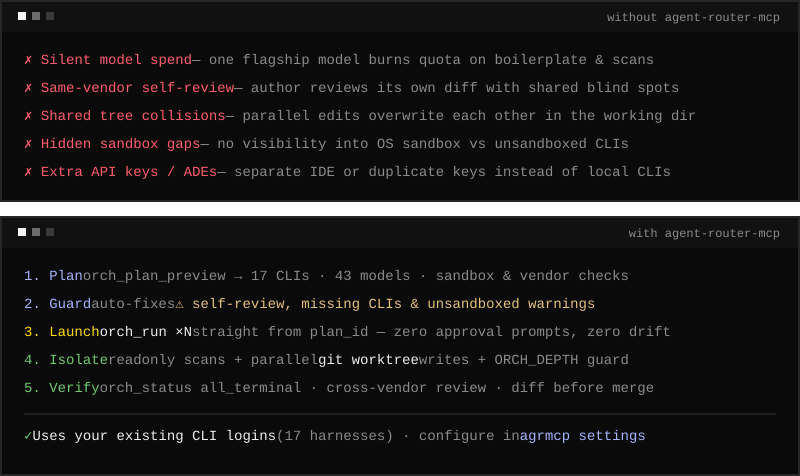
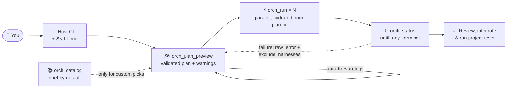

<div align="center">

<br><br>

     <br>
    <br><br>

<a href="README.md">🇬🇧 English</a> · <a href="README.ru.md">🇷🇺 Русский</a> · <a href="README.zh.md">🇨🇳 中文</a>

</div>

# 🧭 agent-router-mcp

> **Universal local MCP model orchestrator for any IDE or standalone CLI** — connect from any MCP client (VS Code, Cursor, Windsurf, Zed, JetBrains, Claude Desktop, Antigravity, or terminal CLIs) and route subtasks across **17 coding CLI harnesses**:                  with autonomous plan-validated execution, git worktree isolation, and a local visual Settings UI.

`agent-router-mcp` is a standalone, client-agnostic `stdio` MCP server — it is **not tied to any specific IDE or UI wrapper**. It pairs a curated two-layer TOML catalog (**17 harnesses, 43 models across 12 labs, 24 aliases, 23 canonical roles, 8 presets**) with a companion cross-CLI skill. Instead of cramming an entire task into one model or spawning silent subagents, your host IDE or CLI builds one validated routing table — model, effort, mode, isolation, cost, sandbox guarantee, and blind-spot warnings — and launches the subtasks in parallel right away, without interrupting you for confirmation. It pauses only when you explicitly ask for a plan or dry-run first.

> [!NOTE]
> `agent-router-mcp` makes **no outbound network requests** itself and never patches your CLIs. It spawns the local CLI binaries you already installed and logged into, inheriting your existing environment, proxies, and custom CA certificates. Custom harnesses and extra profiles are added locally via `agrmcp settings` or `~/.config/orchestrator-mcp/models.toml`.

> [!TIP]
> **Let your coding agent do the setup.** Any AI coding agent (Claude Code, Codex, Gemini, Cursor, and others) can install, configure, or customize this project for you: point it at [`AGENTS.md`](AGENTS.md) and [`docs/AI_AGENT_GUIDE.md`](docs/AI_AGENT_GUIDE.md) — they contain step-by-step playbooks with exact commands and checks.

## ✨ Features

| Feature | What it means |
|---|---|
| 🧩 **17 built-in CLI harnesses** | `claude`, `codex`, `dsh`, `pi`, `antigravity`, `opencode`, `gemini`, `cursor`, `grok`, `kiro`, `fx`, `muse`, `copilot`, `droid`, `qwen`, `kimi`, and `vibe` — plus local custom harnesses via config |
| 🔍 **Automatic model discovery** | `agrmcp models discover` (and **Discover models** in Settings UI) lists the models your installed CLIs already know — offline from their own config/cache files, or on demand with zero-token CLI listing commands — and imports the ones you pick as reviewable cards; `agrmcp doctor` prints an offline hint when unconfigured models are found |
| 🚀 **One-command setup** | `agrmcp setup --target all` registers the MCP server **and** installs the `orchestrate` skill for every CLI detected on this machine, then reads both back to verify them; `agrmcp mcp install \| status \| uninstall` manages MCP entries alone, and `agrmcp doctor` flags drift such as "skill installed, MCP missing" |
| 🔌 **Works from any IDE or CLI** | Standard `stdio` MCP server — plug into VS Code, Cursor, Windsurf, Zed, JetBrains, Claude Desktop, or standalone terminal CLIs |
| ⚡ **Autonomous plan-validated execution** | `orch_plan_preview` builds and validates the plan (cross-vendor review, worktree isolation, sandbox checks); the agent then launches parallel `orch_run` calls immediately, with no confirmation prompts |
| 🔒 **Strict opt-in only** | the orchestrator never fires on its own — `orch_*` tools run only when you explicitly ask to orchestrate (orchestrator, multi-model routing, swarm, `/orchestrate`); once you ask, it runs autonomously without launch-confirmation prompts |
| 🏎️ **Fast MCP ergonomics** | built-in MCP server `instructions`, compact `orch_catalog` (`detail: "brief"` by default), `orch_run` parameter hydration from `plan_id` + `subtask_id`, and event-driven `orch_status` waits with cursor continuation and progress |
| 🔁 **Verbatim errors & smart failover** | failed jobs keep the exact redacted provider error (`raw_error`), a classified `code` (`QUOTA_EXCEEDED`, `RATE_LIMITED`, `PROVIDER_OVERLOADED`, `AUTH_REQUIRED`, `MODEL_UNSUPPORTED`, `PROMPT_TOO_LARGE`, …), `failure_scope`, a verified `safe_to_reroute` flag, and role-aware `suggested_alternatives`; the agent reroutes autonomously and reports it |
| 🔗 **Opt-in portable continuation & auto-pruned runs** | Workers are stateless by default. Set `continue_from_job_id` and, optionally, `context_id` to carry a handoff of up to about 12 KB across all 17 CLIs, including cross-vendor failover, with no persistent state beyond the normal per-job run directory. Automatic retention pruning cleans up old finished runs in `runs/`. |
| ⚡ **Parallelism, sharding & native subagents** | global defaults `max_concurrency = 8` per repository session (`concurrency_scope`) / `host_max_concurrency = 24` / `max_queue_size = 32`; per-harness caps discovered from each CLI's own config (Linux, macOS, Windows); same-model sharding with `subtasks[].shards` (1–8); non-blocking per-harness scheduling; controlled native CLI subagents that are only ever lowered per invocation |
| ♻️ **Progress-preserving retries** | interrupted, timed-out, or failed jobs persist a redacted `checkpoint.json` (partial output, tool trail, changed files, bounded diff); `TIMEOUT` errors carry `has_partial_progress` and a ready `error.resume` call, and the retry resumes with a bounded "Progress before stop" handoff |
| 🧾 **Lenient MCP input** | all 6 tools accept `null` optionals, numeric/boolean strings, singleton or comma-separated lists, and aliases; unknown arguments come back in `ignored_arguments` with closest-key hints; missing required arguments return structured `INVALID_INPUT` with `details.missing` and `details.example` |
| 🌐 **English default, Russian opt-in** | catalog, planner, skill, and Settings UI default to English; Russian via `locale: "ru"` (or `[defaults] locale = "ru"`) and the persistent **EN / RU** switcher in Settings UI |
| 🌿 **Git worktree isolation** | parallel `write` subtasks run in dedicated worktrees under `ORCH_STATE_DIR` and never collide in your working tree |
| 🧠 **Anti-hype default catalog** | 43 models from 12 labs, 23 roles, and 8 universal presets with honest weaknesses, cross-vendor review, automatic uninstalled-CLI fallback, and zero `max` effort traps |
| 🎛️ **Technical Ledger Settings UI** | zero-dependency visual editor (`agrmcp settings`) with operational tables, live harness health and delegation readiness, a master-detail preset matrix, full `[defaults]` editing, a model-discovery review drawer, driver-aware harness and model fields, custom themed dropdowns, a persistent Save bar with status, save-rule cues, a favicon, `/` search, and a strict offline nonce CSP |
| 🛡️ **Guarded execution** | argv-only spawn (no shell), `ORCH_DEPTH` anti-recursion, binary identity checks (`fx`/`agent`), `readonly` enforcement, process-group & grandchild cleanup, secret redaction, and bounded outputs |
| 🧪 **Offline test suite** | 2,685 tests across 52 files covering all 17 drivers, Windows process-tree / sandbox / env-case / T3 Code profile cases, mock-CLI integration, `agrmcp setup` / `agrmcp mcp` config editors, per-session concurrency and activity-aware timeouts, Web UI security, catalog budgeting, docs TOML examples, `agrmcp wait`, CLI limit discovery, model discovery, config quarantine, checkpoints, lenient MCP input, and real `stdio` MCP protocol smoke checks |

## 🎯 What it solves

Routing complex engineering work across specialized coding CLIs without losing control over cost, sandboxing, or file edits:

<div align="center">

<br><sub>Illustration of the workflow and outcome, not a literal screenshot.</sub>
</div>

| ✅ Solves | ❌ Does not |
|---|---|
| picking the right model, CLI, and effort per role with transparent cost/weakness notes | act as an LLM API gateway or proxy — you still use your own local CLIs and logins |
| isolating parallel `write` subagents in separate git worktrees | auto-merge worktree diffs behind your back — the host agent integrates and tests them |
| preventing same-vendor blind spots with automatic cross-vendor review warnings | override a CLI's upstream rate limits, subscriptions, or provider outages — it reroutes around them instead |
| visual catalog tuning without touching repo defaults (sparse user overrides + reset) | force a validated plan on every run by default — the skill always previews first, but the server enforces a valid `plan_id` on `orch_run` only when `require_plan_id = true` (`false` by default) |
| recovering from quota, rate-limit, overload, and auth failures by rerouting to a healthy harness, with the verbatim error preserved | fall back silently — every reroute is explicit, plan-validated, and reported with the original `raw_error` |

## 🚀 Installation

Build the package once, then run `agrmcp setup` to register the `stdio` MCP server and install the companion skill in the CLIs you use, or register the server by hand with the recipes below. Replace `/abs/path/to/agent-router-mcp` with the absolute path to your clone.

<table>
<tr><td width="260"> <br><sub>Build TypeScript &amp; optional global bin link</sub></td><td>

```bash
git clone https://github.com/nazavod777/agent-router-mcp.git && cd agent-router-mcp
npm install
npm run build        # compiles TypeScript to dist/ and bundles Settings UI
npm link             # optional: installs the single global command `agrmcp`
```

</td></tr>
<tr><td width="260"><br><sub><b>Recommended:</b> register MCP + install skill in one step, verified per CLI</sub></td><td>

```bash
agrmcp setup --target all     # every CLI detected on this machine (or: --target claude, --target gemini, ...)
agrmcp setup --dry-run        # preview only; --force overwrites a disabled or foreign "orchestrator" entry
agrmcp mcp status --check     # exit code 1 on drift (for example skill installed but MCP missing)
```

</td></tr>
<tr><td width="260"><br><sub>Manual: any IDE / MCP client (VS Code, Cursor, Windsurf, Zed, JetBrains, Claude Desktop)</sub></td><td>

```json
{
  "mcpServers": {
    "orchestrator": {
      "command": "/abs/path/to/node",
      "args": ["/abs/path/to/agent-router-mcp/dist/cli/main.js", "mcp"]
    }
  }
}
```

</td></tr>
<tr><td width="260"><br><sub>Manual: Claude Code (<code>-s user</code> = all projects; without it only the current project)</sub></td><td>

```bash
claude mcp add -s user orchestrator -- "$(command -v node)" "/abs/path/to/agent-router-mcp/dist/cli/main.js" mcp
```

</td></tr>
<tr><td width="260"><br><sub>Manual: Codex CLI</sub></td><td>

```bash
codex mcp add orchestrator -- "$(command -v node)" "/abs/path/to/agent-router-mcp/dist/cli/main.js" mcp
```

</td></tr>
<tr><td width="260"> <br><sub>Manual: Antigravity or Gemini CLI (<code>--scope user</code> = all projects)</sub></td><td>

```bash
# Antigravity reads ~/.gemini/config/mcp_config.json (legacy: ~/.gemini/antigravity/mcp_config.json; GEMINI_HOME overrides ~/.gemini)
# `agrmcp setup` also finds T3 Code isolated profiles (antigravity:t3:<id>); --target antigravity:primary repairs only the primary one
agy mcp add orchestrator -- "$(command -v node)" "/abs/path/to/agent-router-mcp/dist/cli/main.js" mcp
gemini mcp add --scope user orchestrator "$(command -v node)" "/abs/path/to/agent-router-mcp/dist/cli/main.js" mcp
```

</td></tr>
<tr><td width="260"> <br><sub>Manual: Pi or OpenCode</sub></td><td>

```bash
# Pi >= 0.99.0 has a built-in MCP client that reads ~/.pi/agent/mcp.json
pi mcp add orchestrator -- "$(command -v node)" "/abs/path/to/agent-router-mcp/dist/cli/main.js" mcp
# OpenCode: interactive, or edit opencode.json / opencode.jsonc (comments allowed):
#   V2 -> "mcp": { "servers": { "orchestrator": ... } }    V1 -> "mcp": { "orchestrator": ... }
opencode mcp add
```

</td></tr>
<tr><td width="260"><br><sub>Manual: add to ~/.dsh/cordis.patch.yml</sub></td><td>

```yaml
- insert:
    - id: mcp-orchestrator
      name: '@deepseek-ai/dsh-mcp-client'
      config:
        serverName: orchestrator
        transport: stdio
        command: /abs/path/to/node
        args: [/abs/path/to/agent-router-mcp/dist/cli/main.js, mcp]
```

</td></tr>
<tr><td width="260"><br><sub>Manage MCP entries, skill &amp; verify CLIs</sub></td><td>

```bash
agrmcp mcp install [--target <cli>|all] [--dry-run] [--force] [--json]  # MCP entry only
agrmcp mcp status [--target <cli>|all] [--check] [--json]               # missing / current / stale / disabled / conflict / invalid
agrmcp mcp uninstall [--target <cli>|all] [--dry-run] [--force]         # remove only the orchestrator entry
agrmcp skill install                 # skill only: 4 core CLIs + every other detected CLI
agrmcp skill install --target gemini # skill into one specific CLI
agrmcp doctor                        # 17 harnesses + "MCP client registrations" table
```

</td></tr>
</table>

> [!TIP]
> `agrmcp setup` and `agrmcp mcp install` always write the absolute `node` path and this build's `dist/cli/main.js` (atomic write with a backup of the previous file), and `--target all` selects only the CLIs detected on this machine; `agrmcp mcp status` reports `stale` when an entry points at another build. Writing an entry by hand? Use the absolute path to `node` (`$(command -v node)`; in Windows PowerShell `(Get-Command node).Source`) as the `command` in GUI clients, because they often miss nvm/asdf `PATH` and never rely on a bare `node`; VS Code uses the top-level key `"servers"` and Zed uses `"context_servers"` instead of `"mcpServers"`. Without `npm link`, wherever this README writes `agrmcp`, run `node "/abs/path/to/agent-router-mcp/dist/cli/main.js"` instead (for example `node "/abs/path/to/agent-router-mcp/dist/cli/main.js" doctor`). After `npm link`, you can pass `agrmcp mcp` directly instead of `node "/abs/path/to/agent-router-mcp/dist/cli/main.js" mcp`. Upgrading from an older release? Legacy `orchestrator-mcp` / `orch mcp` entries in existing CLI configs are migrated automatically by `agrmcp setup` (no `--force` needed), and `agrmcp doctor` flags stale global `orch` / `orchestrator-mcp` / `orchestrate-settings` symlinks so you can remove them. To upgrade: `git pull && npm install && npm run build && npm link`, then `agrmcp setup --target all && agrmcp mcp status --check`, and remove any symlinks flagged by `agrmcp doctor`. For `dsh`, verify the merged config with `dsh --profile <profile> --dump-config`. `agrmcp skill install --target all` (also the default without `--target`) installs the skill only and never touches MCP entries: it always writes the 4 core skill directories (`claude`, `codex`, `dsh`, `pi`), creating them if needed, plus every other supported CLI detected on this machine (its binary is on `PATH`, or its own config directory is not empty), so CLIs you do not have get no empty folders in `$HOME`. Run `agrmcp setup` to get the MCP entry and the skill together.

### 📋 Requirements

-  **22.12+** and  (TypeScript 5.9, ESM); contributors running the tests need Node.js `>= 22.12` (or `^24` / `>= 26`) for Vitest 5
-  required for `write` subtasks using isolated `worktree` mode
- At least one installed & authenticated coding CLI from the 17 supported harnesses below
-  primary verified OS (full `/proc` + `ORCH_JOB_CHAIN` grandchild reaping);  uses POSIX process groups and  uses `taskkill /T` instead of process groups (see [Limitations](#%EF%B8%8F-limitations))

## 🔌 Supported harnesses (17 built-in drivers)

Single source of truth: [`src/drivers.ts`](src/drivers.ts). All 17 harnesses are enabled by default in [`defaults/catalog.toml`](defaults/catalog.toml); uninstalled CLIs are skipped cleanly during `orch_plan_preview` auto-routing when an installed replacement exists.

| Harness | Binary | Contract | Readonly | Write | Prompt | Effort | MCP isolation |
|---|---|---|---|---|---|---|---|
|  `claude` | `claude` | `verified` | `tool_allowlist` | `tool_allowlist` | stdin | native | flag |
|  `codex` | `codex` | `verified` | `os_sandbox` | `os_sandbox` | stdin | native | config |
|  `dsh` | `dsh` | `verified` | `os_sandbox` | `os_sandbox` | stdin | native | config |
|  `pi` | `pi` | `verified` | `tool_allowlist` | `unsandboxed` | stdin | native | flag |
|  `antigravity` | `agy` | `verified` | `tool_allowlist` | `unsandboxed` | argv | native | none |
|  `opencode` | `opencode` | `verified` | `tool_allowlist` | `unsandboxed` | stdin | variant | config |
|  `gemini` | `gemini` | `verified` | `tool_allowlist` | `unsandboxed` | stdin | none | flag |
|  `cursor` | `cursor-agent` | `experimental` | `tool_allowlist` | `unsandboxed` | argv | none | none |
|  `grok` | `grok` | `experimental` | `tool_allowlist` | `unsandboxed` | argv | none | none |
|  `kiro` | `kiro-cli` | `experimental` | `tool_allowlist` | `unsandboxed` | argv | none | none |
|  `fx` | `fx` | `experimental` | `unsandboxed` *(blocked)* | `unsandboxed` | argv | native | none |
|  `muse` | `muse` | `experimental` | `tool_allowlist` | `unsandboxed` | 0600 file | none | none |
|  `copilot` | `copilot` | `experimental` | `tool_allowlist` | `unsandboxed` | argv | none | none |
|  `droid` | `droid` | `experimental` | `tool_allowlist` | `unsandboxed` | 0600 file | native | none |
|  `qwen` | `qwen` | `experimental` | `tool_allowlist` | `unsandboxed` | stdin | none | flag |
|  `kimi` | `kimi` | `experimental` | `tool_allowlist` | `unsandboxed` | argv | none | none |
|  `vibe` | `vibe` | `experimental` | `tool_allowlist` | `unsandboxed` | argv | none | none |

> [!IMPORTANT]
> **`verified`** means flags, output format, and probes were verified directly against the live CLI binary on Linux. **`experimental`** means the adapter follows documented CLI contracts and offline mock tests; `orch_plan_preview` flags it clearly and prefers `verified` harnesses during automatic fallback. `fx` cannot currently guarantee readonly mode, so `readonly` tasks on `fx` are rejected upfront with `SANDBOX_POLICY_VIOLATION`.

## ⚙️ How it works



The full workflow is encoded in [`skills/orchestrate/SKILL.md`](skills/orchestrate/SKILL.md):

1. **Fast triage** — simple single-step work stays in the current CLI; multi-file, cross-domain, or review-critical work enters orchestration. The host does not pre-read large files — workers read them directly.
2. **`orch_plan_preview`** — called directly for standard presets. Decomposes the request into subtasks and returns exact model, effort, `readonly`/`write` mode, worktree isolation, relative cost, sandbox guarantee, and warnings (stale cards, `max` effort cost, unsandboxed write, experimental driver, cross-vendor self-review). `orch_catalog` is needed only to pick a specific model (`detail: "brief"` by default; `detail: "full"` for full model cards and per-harness `concurrency`, while full preset role maps need `preset: "<id>"` or `include_preset_roles: true`).
3. **Auto-fix warnings** — the agent resolves self-review, missing/unauthenticated harnesses, unsandboxed writes, and premium models with at most one re-preview, then reports what changed.
4. **Autonomous launch** — all independent subtasks start in one turn via parallel `orch_run({ plan_id, subtask_id, prompt, cwd, async: true, client_request_id })`; harness, model, effort, mode, and isolation are hydrated from the saved plan. No confirmation prompts — the agent pauses only if you explicitly asked for a plan, dry-run, or cost estimate first.
5. **Efficient waiting** — Prefer `agrmcp wait --job <id> [--job <id> ...]` when the host supports asynchronous shell notifications: launch async `orch_run` jobs and one background wait, then resume on its notification. Otherwise call `orch_status({ plan_id, wait_ms: 600000, until: "any_terminal" })`; the server calibrates the wait to the host timeout, sends `notifications/progress` when supported, and returns an opaque `cursor` in `next.args`; the MCP client supplies `_meta.progressToken` and receives the server's `notifications/progress` heartbeats. Follow `next.args` while `pending_count > 0 || unseen_count > 0`, that is, whenever `next` is returned (including when finished jobs were truncated). Event delivery wakes the call; close completions may be coalesced for about 1.5 seconds. Both approaches avoid polling loops; `orch_logs` and `orch_cancel` cover output and cancellation.
6. **Verbatim failures & smart rerouting** — a failed job returns its exact `raw_error`, `code`, `failure_scope`, `safe_to_reroute`, and `suggested_alternatives`; the agent re-plans with `exclude_harnesses` / `exclude_models` and relaunches (max 2 reroutes per subtask, never for `TIMEOUT`) without asking — details below.
7. **Integration** — the host agent inspects results, transfers worktree diffs, runs your project's real test suite, removes worktrees only after integration succeeds, and reports the final routing table, including any failover chain.

**Strict opt-in and the multi-model Design Gate:** the skill and the MCP server instructions only enter orchestration when you explicitly ask for it. Before a major change to an external contract, a safety/sandbox boundary, a persistence schema, or failover/concurrency semantics, the agent first consults 1–2 readonly advisors from other vendors with the full sequence `orch_plan_preview({ intent: "design_consult", host_vendor?, ... })` → launch the advisors with `orch_run` → wait with `orch_status({ plan_id, until: "all_terminal" })` → synthesize their answers and record the decision before writing code. Local, reversible fixes skip this step.

### 🔁 Verbatim errors & smart failover

When a job fails or times out, `orch_status` and `orch_run` return a structured `error` instead of a vague "failed":

| Field | Meaning |
|---|---|
| `code` | classified cause: `QUOTA_EXCEEDED`, `RATE_LIMITED`, `PROVIDER_OVERLOADED`, `AUTH_REQUIRED`, `MODEL_UNSUPPORTED`, `CLI_NOT_FOUND`, `HARNESS_UNAVAILABLE`, `PROMPT_TOO_LARGE`, `TIMEOUT`, `NON_ZERO_EXIT`, `PARSE_ERROR`, … |
| `raw_error` / `stderr_tail` | the exact CLI/provider error, secret-redacted but never stripped from `orch_status`; `orch_status` clips `raw_error` to 1,500 bytes (use `orch_logs` for the full saved output) |
| `failure_scope` | `harness` (whole account or CLI: quota, auth, rate limit, overload), `model` (only that model), or `job` (this run only) |
| `safe_to_reroute` | `true` when a rerun cannot overwrite partial edits and no process may still be running: normally `true` for `readonly` and `worktree`, but a failed process-tree termination returns `false` even there; for `shared` writes, verified by comparing git tree status before and after the job |
| `suggested_alternatives` | ranked role-matched replacements on healthy harnesses (never for `TIMEOUT`); harness-scope errors exclude the failed harness, and sandbox rules and cross-vendor review stay intact |

**Session cooldowns:** a harness failing with `QUOTA_EXCEEDED`, `AUTH_REQUIRED`, or `CLI_NOT_FOUND` cools down for 10 min; `RATE_LIMITED` or `PROVIDER_OVERLOADED` for 2 min; a model failing with `MODEL_UNSUPPORTED` for 10 min. During a cooldown, `orch_plan_preview` steers away from the degraded harness or model with a warning; the cooldown clears on the next success or with `refresh_health: true`. You can also exclude explicitly with `exclude_harnesses` and `exclude_models`:

```js
orch_plan_preview({ cwd, subtasks, exclude_harnesses: ["codex"] })  // after QUOTA_EXCEEDED on codex
```

The companion skill uses these fields to recover autonomously (max 2 reroutes per subtask). It always checks for `safe_to_reroute: true` before rerouting, even in `readonly` and `worktree`, because a failed process-tree termination returns `safe_to_reroute: false` there too. With `safe_to_reroute: false` it stops that subtask and reports to the user: it never reroutes to another harness and never launches a second concurrent writer on the same checkout, because after an unconfirmed process-tree termination the old process may still be writing; the final report lists every failover chain with the original `raw_error`.

**Hard stop and timeout:** stop all work and tell the user when `DELEGATION_UNAVAILABLE` is returned, a plan reports `launchable: false` or `delegation_status: "exhausted"`, or `delegation_state` is `exhausted`; do not run blocked subtasks yourself or switch delegators. For `TIMEOUT`, check the termination warnings first: if process termination failed (`safe_to_reroute: false`, no `error.resume`), do not blindly resume into a poisoned checkout; otherwise send `orch_run(error.resume.args)` as given (it includes `plan_id` and `subtask_id` for `require_plan_id = true` deployments) on the same model, and branch on `error.timeout_kind`: `soft` allows a larger `timeout_sec`, `idle` (the CLI stalled) means check `error.stderr_tail`, auth, and quota and resume without raising `timeout_sec`, and `hard` (the cap was reached) means split the work on that model. Inter-model payloads must be in English; reply to the user in their language.

Job timeouts default to 900 seconds, or 1800 seconds at `high`, `xhigh`, and `max` effort; omit `timeout_sec` and let the server choose. **Activity-aware anti-timeout:** with `auto_extend_timeout = true` (default), a streaming job that produced output, stderr, or CPU activity within the last `activity_window_sec = 180` seconds gets its soft deadline moved by `timeout_extension_sec = 600` seconds, repeatedly, up to the 3600-second `max_timeout_sec` cap; a streaming job with no activity for `idle_timeout_sec = 900` seconds is stopped early as idle (`0` disables idle detection); and `strict_timeout: true` turns extension off for a hard wall-clock limit.

### ⚡ Parallelism, sharding & native subagents

- **Global limits (per-session concurrency):** `max_concurrency = 8` running jobs per session, where `concurrency_scope` chooses what a session is: `repo` (default; one repository, worktrees fold into their main repo), `context` (one `context_id`), or `global` (the whole host). `host_max_concurrency = 24` is the ceiling across all sessions (effective cap `max(host_max_concurrency, max_concurrency)`), and `max_queue_size = 32` queued jobs by default; `QUEUE_FULL` carries `details.scope` (`session` or `host`); `orch_max_depth` stays `1`.
- **CLI limit discovery:** `src/config/cli-limits.ts` reads the real concurrency and depth settings from your local CLI configs on Linux, macOS, and Windows: Codex `config.toml`, Claude `settings.json` plus managed settings, OpenCode `opencode.json`/`opencode.jsonc`, DSH profiles and `cordis.patch.yml`, and Gemini/Pi `settings.json`. Only when a CLI states no limit does the harness fall back to `default_harness_concurrency = 5`; `harnesses.<id>.max_concurrency` overrides both. The effective per-harness cap is `min(max_concurrency, override ?? CLI limit ?? default_harness_concurrency)`.
- **Same-model sharding:** split one subtask with `subtasks[].shards`, or plan several subtasks on one model, up to that harness's `effective_cap`. `shards: 1` is the same as omitting `shards` (pass an explicit `isolation: "worktree"` for an isolated single write job); `shards: 2..8` expands into `<id>#1..<id>#N` and forces `isolation: "worktree"` for writes. `readonly` shards share the working tree. Scheduling is non-blocking per harness, so a saturated harness never holds back an idle one.
- **Controlled native subagents:** `native_subagents` (`"cli_limit"` or `"off"`, default `"cli_limit"`) and `native_subagent_depth` (0–3, default `2`) can only lower a CLI's own subagent limits for one invocation. The clamp is actively enforced by `claude`, `codex`, `opencode`, and `dsh` (`pi` already disables extensions via `--no-extensions`); other CLIs (for example `gemini` and the experimental drivers) have no per-run enforcement flag and report `unknown` with a warning. User CLI config files are never modified, and global `inherit_mcp` is never enabled.
- **Where to see it:** `orch_catalog` (per harness), `orch_plan_preview` (`plan.concurrency`), and `agrmcp doctor` (`--json` and the table).

### ♻️ Progress-preserving retries

- **Streaming Claude output:** `claude` runs with `--output-format stream-json --verbose` (still with `--no-session-persistence`), so partial progress is visible in real time; `tool_result` bodies are stripped from `stdout.log`.
- **Checkpoint:** an interrupted, timed-out, or failed job writes a redacted `0600` `checkpoint.json` with the partial assistant output, a compact tool-activity trail, and the changed files plus a bounded diff excerpt (from the job's worktree, or scoped to a shared write). Read it with `orch_logs({ job_id, part: "checkpoint" })`.
- **Resume:** `TIMEOUT` errors include `has_partial_progress` and, when the process tree ended cleanly, a ready `error.resume` call (use `error.resume.args` as given; check the termination warnings first). Continuing through `continue_from_job_id` (or automatically, when you re-run a timed-out `plan_id` + `subtask_id`; pass `fresh: true` to opt out) prepends a bounded handoff of up to 16 KB titled "Progress before stop" and reuses a clean worktree, so the retry picks up where the worker stopped.

## 🎛️ Visual Settings UI

Run `agrmcp settings [--no-open] [--port N]` to open the local Technical Ledger workbench. It runs on Node `http` and bundles all assets for offline use.

| Tab | What you manage |
|---|---|
| 🤖 **Models** | Search with `/` or `Ctrl+K`; filter by harness/tier; edit model details (including `vendor_family`, with the inferred vendor shown as a hint); reset one field or the full model; add custom models; **Discover models** to review and import models your CLIs report |
| 🔌 **Harnesses** | Operational tables with live harness health and delegation readiness; inspect install, version, auth, contract, and sandbox guarantees; add custom harnesses; edit `extra_args` one argument per row, 3-state `inherit_mcp`, `max_concurrency`, and `model_discovery`; fields the driver does not read are hidden or flagged |
| 📋 **Presets** | Master-detail view with a role-to-harness-to-model-to-effort matrix for all 23 roles and automatic compatibility filtering |
| 🛡️ **Limits & Security** | Complete `[defaults]` editor with grouped settings, validation, and per-field reset |

Dropdowns are custom themed controls, the `[defaults]` editor keeps a persistent Save bar with live status, pages show save-rule cues (switches save immediately; entries save from their editor), and the UI ships its own favicon. The interface is in English by default; the persistent **EN / RU** switcher in the sidebar turns on Russian and remembers your choice. A strict offline nonce Content Security Policy (CSP) authorizes only scripts and styles carrying the per-response nonce and blocks remote assets. Keyboard shortcuts: `/` or `Ctrl+K` focuses model search; `Alt+1`–`Alt+4` switches tabs; `Ctrl+S` saves the open editor; `Esc` closes a drawer or mobile navigation.

Configuration uses a **two-layer sparse override model**:

1. **Built-in catalog** — [`defaults/catalog.toml`](defaults/catalog.toml), updated with the package and never edited by hand.
2. **User overrides** — `~/.config/orchestrator-mcp/models.toml` (or `$XDG_CONFIG_HOME/orchestrator-mcp/models.toml`), written with mode `0600` and storing **only deltas** from defaults. When a built-in default later updates, the UI highlights **"default updated"** next to your override.

All writes use file locks and revision checks (returning `409 Conflict` instead of clobbering concurrent edits). A corrupted user file never breaks the MCP server: if one harness, model, preset, or alias override is malformed or conflicts with the rest, only that entity is **quarantined** (listed in `quarantined` and `config_warnings` with a redacted reason, and shown as a banner in the UI) while every other override still applies and stays editable; only a file that cannot be parsed at all (TOML syntax, an unknown top-level section) or an invalid `[defaults]` value falls back to the last valid config or the built-in catalog with a warning. Full reset always saves a timestamped backup `models.toml.bak.<timestamp>`.

**Fail-closed cold start (`cold_start_fallback`):** if `models.toml` is broken when the MCP server starts, and there is no earlier valid config in memory, the server reports `cold_start_fallback: true` and refuses to run jobs with `CONFIG_INVALID` instead of running with weakened defaults; repair the file (`agrmcp config show --json` shows `config_warnings`) or reset it, and runs resume. Each quarantined item has its own **Reset** button in the UI banner (`agrmcp config reset <target>` in the shell). **Lock scope:** the lock file protects concurrent `agrmcp` writers (CLI and Settings UI); a manual edit in your editor takes no lock and is caught by the revision check made just before the atomic rename, which then returns `409 Conflict`. **Windows:** `0600` is a POSIX permission; on Windows keep the config and state directories inside your private user profile (for example under `%USERPROFILE%` or `%LOCALAPPDATA%`), not in a shared folder, because NTFS does not enforce `0600`.

### Custom harnesses and models

Add local wrapper binaries or extra profiles on top of any of the 17 drivers via **Harnesses → + Add harness** and **Models → + Add model** in `agrmcp settings` (or directly in `~/.config/orchestrator-mcp/models.toml` with `custom = true`), or tweak individual settings from the terminal:

```bash
# adjust one role in a preset
agrmcp config set presets.balanced.roles.quick.effort medium

# disable a model you do not have; presets fall back across the catalog
agrmcp config set models.pi-grok-4.7.enabled false

# IDs with dots, slashes, or colons: quote the ID segment, or use --section/--id/--field
agrmcp config get 'models."pi-grok-4.7".tier'
agrmcp config set --section models --id pi-grok-4.7 --field enabled true

# a short alias for a model ID, and a single-field harness reset
agrmcp config set aliases.fast claude-haiku-5-5
agrmcp config reset harnesses.codex.max_concurrency
```

- **IDs:** new harness, model, preset, and alias IDs start with a letter or digit and may contain letters, digits, `.`, `_`, `-`, `/`, `:`, and `@` (at most 128 characters; no `..`, `//`, or trailing `/`). Setting an unknown ID to a whole JSON object creates a new custom entity.
- **Aliases:** `agrmcp config set aliases.<alias> <model-id>` and `agrmcp config reset aliases.<alias>`; a real model ID always wins over an alias of the same name (a shadowed alias gets a warning).
- **`inherit_mcp` has 3 states on a harness:** unset (follow `defaults.inherit_mcp`), `true`, or `false`. Built-in harnesses no longer pin `false`, so changing `defaults.inherit_mcp` reaches them. To clear an inherited optional field, use `_unset`, for example `agrmcp config set harnesses.<id>._unset '["inherit_mcp"]'`.
- **`model_discovery`** on a harness: `native` (the CLI lists its own models), `wrapper` (a wrapper script may be asked to list them), or `manual` (never probed). Default: `native` for built-in binaries, `manual` for custom wrappers and path-based binaries.
- **Driver-aware checks:** `agrmcp doctor` warns about fields a driver never reads (for example `profile` outside `codex`/`dsh`) and about OpenCode models without a provider (`cli_provider` or a `provider/model` `cli_model`). Vendor inference for cross-vendor review understands aggregator CLIs (including Pi's `default_upstream_provider`), and the planner prefers curated or reviewed cards over auto-generated ones when both fit equally well.

### Automatic model discovery

```bash
agrmcp models discover                      # preview: every enabled harness, CLIs + local files; nothing is written
agrmcp models discover --offline            # local config/cache files only; no CLI is started
agrmcp models discover --harness opencode --json
agrmcp models discover --apply --select <key>[,<key>...] --revision <rev>
agrmcp models discover --apply --all-new --revision <rev>   # every new model, at most 50 per call
```

- **Offline layer:** reads each CLI's own local config and cache files (allowlisted model fields only, never credential files); no subprocess and no network. `agrmcp doctor` runs it within a 45 ms budget and prints `Discovery hint: N unconfigured models detected locally` (`discovery_hints` in `--json`).
- **On-demand layer:** runs fixed listing commands that start no LLM session and spend no tokens (for example `opencode models`, `pi --no-extensions --no-mcp --no-approve --offline --list-models`, `gemini models list` only when `gemini --help` advertises it), with an allowlisted environment, 5 s per probe, 15 s overall, at most 2 probes at once, bounded output, process-tree cleanup, and redaction of secrets and URL credentials. `extra_args` are never appended.
- **Review:** candidates are `new` (imported as a new card), `disabled_in_catalog` (selecting it re-enables the one existing disabled card), `ambiguous` (several disabled cards match; nothing is changed), or `already_configured`, actionable ones first. `--all-new` imports only `new` models; use `--select` (not combinable with `--all-new`) to re-enable a disabled card. Imported cards are marked `source = "discovered"` with `metadata_quality = "template"` (copied from a matching built-in card) or `"baseline"` (generic card to review). `--revision` makes `--apply` fail if the config changed since the preview. `--all` also lists models from providers a CLI reports as not connected.

In **Settings UI**, **Discover models** (Models header, and each saved harness drawer) opens a review drawer with an On-demand / Offline mode switch, a harness picker, per-harness diagnostics, search and status/provider filters, and checkboxes for up to 50 models, imported in one atomic batch.

## 🧠 Default catalog

Built-in model cards are verified as of `2026-11-25` (`checked_at`). After `stale_after_days = 90`, plan previews flag aging cards automatically.

### 43 models across 12 labs & 17 harnesses

| Lab / Platform | Harnesses | Models |
|---|---|---|
| Anthropic |  | `claude-opus-5-5`, `claude-sonnet-5-5`, `claude-fable-5-2`, `claude-haiku-5-5` |
| OpenAI |  | `gpt-6.2-astra`, `gpt-6.2-sol`, `gpt-6.1-terra`, `gpt-6-luna` |
| Google Gemini |    | `agy-gemini-4-neon`, `agy-gemini-4-argon`, `agy-gemini-3.8-flash`, `gemini-cli-4-argon`, `gemini-cli-3.8-flash`, `pi-gemini-4-argon` |
| DeepSeek |   | `deepseek-flash` (V4.1 Flash 1017), `deepseek-v4-pro`, `pi-deepseek-v4.1-flash`, `pi-deepseek-v4-pro` |
| Zhipu GLM |  | `pi-glm-5.3`, `pi-glm-5.3-flash`, `pi-glm-5.3-highspeed` |
| Moonshot Kimi |   | `kimi-cli-k3.1-pro`, `pi-kimi-k3.1-pro`, `pi-kimi-k2.7-code`, `pi-kimi-k3` |
| Alibaba Qwen |   | `qwen-cli-3.8-max`, `pi-qwen4-max`, `pi-qwen3.8-max`, `pi-qwen3.8-flash` |
| MiniMax |  | `pi-minimax-m3.1-flash`, `pi-minimax-m3` |
| Xiaomi MiMo |  | `pi-mimo-v2.6-pro`, `pi-mimo-v2.6-flash` |
| xAI Grok |   | `grok-build-4.7`, `pi-grok-4.7` |
| Meta / Mistral |   | `muse-spark-1.3`, `vibe-devstral` |
| Multi-provider CLIs |       | `opencode-default`, `cursor-auto`, `kiro-default`, `fx-default`, `copilot-default`, `droid-default` |

24 short aliases (such as `gpt-sol`, `claude-fable`, `agy-neon`, `grok-build`, `muse-spark`, `kimi-k3.1-pro`) map cleanly to full catalog IDs. Every card documents both strengths and **honest weaknesses**.

### Why these defaults — anti-hype principles

- **`max` effort trap:** `max` routinely burns multiples more tokens with minimal gain over `high`/`xhigh` (e.g., Opus 5.5 at ~173K output tokens/task, Sonnet 5.5 at ~$10/task). **No preset uses `max` by default** — you can still pick it explicitly and see the warning in preview.
- **Harness matters as much as weights:** models are rated inside the CLI harness that runs them. Grok 4.7 scores 37.6% on Terminal-Bench 4 in native Grok Build (`grok-build-4.7`) vs 24–29% in neutral harnesses (`pi-grok-4.7`), where presets restrict it to fast `low`-effort readonly recon.
- **Real terminal evals over saturated leaderboards:** calibrated on independent agentic suites (Vals & Snorkel Terminal-Bench, SWE-Atlas, FrontierSWE) — showing DeepSeek V4.1 Flash beating older V4 Pro, and GPT-6.2 Sol matching Astra's terminal reliability at ~¼ the cost.
- **Known blind spots are baked in:** Sol loses accuracy on codebase Q&A (−14 pts on SWE-Atlas-QnA) so it is kept off `codebase_qa`/`research`; Fable 5.2 misses nitpicks on code review so it stays off `review`; Gemini 4 Argon's lowest hallucination rate (4.3%) puts it on research and visual review.
- **Cross-vendor review:** code written by Claude is reviewed by Codex and vice versa — explicit `vendor_family` + dynamic inference catches same-vendor self-review even across different harnesses (e.g., `antigravity` + `gemini` + `pi-gemini` are all `google`).

### 23 canonical roles

Source of truth: [`src/roles/registry.ts`](src/roles/registry.ts). Each role defines a default mode (`readonly` or `write`) that can still be overridden per subtask in the plan.

| Default mode | Roles |
|---|---|
| 🔎 `readonly` (13) | `architecture`, `research`, `codebase_qa`, `repo_recon`, `ui_review`, `root_cause`, `review`, `second_opinion`, `security`, `test_strategy`, `performance`, `data_sql`, `long_context` |
| ✏️ `write` (10) | `implementation`, `frontend`, `ui`, `ui_design`, `deep_refactor`, `debugging`, `testing`, `devops`, `writing`, `quick` |

### 8 presets

| Preset | Best for | Core lineup |
|---|---|---|
| `balanced` *(default)* | Everyday engineering | Opus architecture, Sonnet implementation, Fable UI, Sol/Astra review & security, DeepSeek Flash recon, Kimi K3.1 Pro long-context, Gemini Argon facts & UI review |
| `max-quality` | High-stakes changes | Fable & Opus on `high`, Astra & Sol on `xhigh`, strict cross-vendor review |
| `budget` | Max output per dollar | DeepSeek Flash & V4 Pro, Kimi K2.7 Code, GLM-5.3, Qwen 3.8 Flash, MiniMax M3.1 Flash, MiMo v2.6 Pro |
| `open-weights` | Zero proprietary Western models | DeepSeek, Kimi, GLM, Qwen 3.8, MiniMax, MiMo |
| `ui-sprint` | UI & frontend delivery | Fable design/UI, Sol frontend code, Gemini Argon screenshot review, Qwen4 Max second opinion |
| `security-audit` | Defensive security audit | Opus & Astra (`xhigh`) cross-auditing each other, GLM-5.3 second opinion, Grok 4.7 (`low`) fast recon |
| `deep-refactor` | Large multi-file migrations | Fable (`high`) editing, Kimi K3.1 Pro repo mapping, Astra & Sol (`xhigh`), Astra review |
| `fast-sprint` | Lowest latency | Sonnet & Sol (`medium`), Haiku, Terra, DeepSeek Flash, GLM-5.3 Highspeed, MiniMax M3.1 Flash |

> [!IMPORTANT]
> In `budget` and `open-weights`, several roles route through Pi whose `write` mode runs `unsandboxed`. Debugging, testing, and DevOps write roles therefore default to `dsh` (OS-sandboxed). Set `allow_unsandboxed_write = false` to reject unsandboxed writes completely — `orch_plan_preview` will automatically propose safe fallbacks.

## 🧰 MCP tools & CLI

### MCP tools (`stdio`)

| Tool | Purpose |
|---|---|
| `orch_catalog` | Compact catalog by default (`detail: "brief"`): harnesses, filtered/paged model cards (`offset`/`next_offset`), roles, and presets; `detail: "full"` adds full model cards and per-harness `concurrency`; full preset role maps need `preset: "<id>"` or `include_preset_roles: true`. Each harness also reports its effective parallel cap and native-subagent depth. |
| `orch_plan_preview` | Build a validated routing plan (`plan_id`) with effort, isolation, cost estimate, sandbox guarantees, auto-fallback for missing CLIs, warnings, and a `markdown_table`; `locale: "ru"` for a Russian table; `exclude_harnesses` / `exclude_models` steer around failed or unwanted harnesses and models (session cooldowns apply automatically); `intent: "design_consult"` with optional `host_vendor` warns unless advisors come from other vendors — the multi-model **Design Gate** before contract, safety, schema, or failover changes. An optional `context_id` scopes continuation to one user prompt and is inherited by runs from the plan. `subtasks[].shards` (`1` equals omitting it; `2..8` splits a subtask into same-model shards) and `plan.concurrency` reports global and per-harness caps. |
| `orch_run` | Execute a planned subtask (`sync` or `async`) with idempotent `client_request_id`; `plan_id` + `subtask_id` hydrate harness, model, effort, mode, and isolation automatically. Optional `continue_from_job_id` resumes work from a prior job within the same scope: the prior job must be finished, in the same `cwd`, within the last 2 hours, and share `context_id` (or `plan_id` if none). This call also accepts `context_id`. `fresh: true` discards saved progress of an earlier timed-out attempt. `cwd` is hydrated from `plan_id` or `continue_from_job_id`, and a continuation gets a deterministic default prompt. |
| `orch_status` | Event-driven wait (up to 600 seconds) or snapshot of jobs by ID or `plan_id`; `until: "any_terminal"`, `"all_terminal"`, or `"any_change"`; opaque `cursor` continuation via `next.args` while `pending_count > 0 \|\| unseen_count > 0`; the client supplies `_meta.progressToken` and receives `notifications/progress` when supported; failures carry `raw_error`, `code`, `failure_scope`, `safe_to_reroute`, and `suggested_alternatives` |
| `orch_logs` | Read bounded output for a job: `part` is `summary`, `stdout`, `stderr`, `diff`, `files`, or `checkpoint` (partial output, tool trail, changed files after an interrupted job) |
| `orch_cancel` | Terminate a running job, its process group, and escaped grandchildren |

**Lenient input:** all 6 tools accept `null` optional fields, numeric and boolean strings (`"600"`, `"true"`, `"false"`, `"yes"`, `"no"`), singleton or comma-separated strings for list fields, and an `orch_status` `job_id` alias. Unknown argument names are reported in `ignored_arguments` with closest-key hints. Missing or blank required arguments return a structured `INVALID_INPUT` error with `details.missing` and `details.example` instead of an opaque `-32602`. `tools/list` still publishes clean, flat Draft-7 JSON Schema.

### CLI commands

| Command | Purpose |
|---|---|
| `agrmcp mcp` | Start the `stdio` MCP server |
| `agrmcp setup [--target <cli>\|all] [--dry-run] [--force] [--json]` | One-command setup: registers the MCP server **and** installs the `orchestrate` skill for each target (`all` = CLIs detected on this machine), then reads both back; a target that is not `current` afterwards (for example a disabled entry left untouched) is reported as `verified: false` with an `unverified_reason`; exit code `1` if any target fails (error, `conflict`, or `invalid` entry) |
| `agrmcp mcp install\|status\|uninstall [--target <cli>\|all] [--dry-run] [--force] [--check] [--json]` | Manage the MCP entry alone in the 17 CLI configs; `status --check` exits `1` on drift: any MCP status other than `current` (missing, stale, disabled, conflicting, or invalid entry), or a missing or outdated skill, even when the skill is current; `--force` overwrites a disabled or foreign `orchestrator` entry |
| `agrmcp settings [--no-open] [--port N]` | Launch the local Settings Web UI in your browser |
| `agrmcp doctor [--json]` | Probe all 17 harnesses (max 4 concurrent), showing version, auth, contract, sandbox guarantees, parallel/depth limits discovered from each CLI's own config, and config health (driver-aware `config_diagnostics`, custom-wrapper warnings, and an offline `discovery_hints` count of unconfigured models); also prints the `MCP client registrations` table (`mcp_clients[]` in `--json`) and warns on drift, for example a CLI with the skill installed while its MCP entry is missing, disabled, or stale |
| `agrmcp models discover [--harness <id>] [--offline] [--all] [--json]` | Preview models the installed CLIs report or keep in their own config (nothing is written); add `--apply --select <key>[,<key>...]` or `--apply --all-new` (at most 50 per call) and `--revision <rev>` to import them |
| `agrmcp wait --job <id> [--job <id> ...] [--until any\|all] [--timeout <sec>] [--settle-ms <ms>] [--state-dir <path>]` | Event-driven wait using kernel `fs.watch` and a 5-second safety fallback; accepts positional IDs or comma-separated `--job` values; defaults to `any`, 1800 seconds (maximum 7200), and a 1500 ms settle window; exit code `0` terminal (`any` or `all`), `2` timeout, `130` cancelled (SIGINT/SIGTERM) |
| `agrmcp config path\|show\|get\|set\|reset` | Inspect, modify, or reset sparse user configuration from the shell; dotted paths may quote an ID (`models."<id>".tier`), or use `--section <defaults\|harnesses\|models\|presets\|aliases> --id <id> [--field <field>]`; `reset` accepts `aliases`, `aliases.<id>`, `models.<id>.<field>`, and `harnesses.<id>.<field>` |
| `agrmcp skill print\|path\|install [--target <cli>\|all] [--dir <path>]` | Print or install `skills/orchestrate/SKILL.md` into supported CLI skill directories |

## 🔐 Security model

- **`os_sandbox`** (`codex`, `dsh`) — filesystem/execution restricted by an OS sandbox.
- **`tool_allowlist`** (e.g., `claude`, `pi`/`antigravity`/`opencode`/`gemini`/`cursor`/`grok`/`kiro`/`muse`/`copilot`/`droid`/`qwen`/`kimi`/`vibe` in `readonly`) — CLI restricts available tools (such as `OPENCODE_CONFIG_CONTENT` v2 deny-all + `read/grep/glob/list`, private 0600 `kimi` readonly agent file, `--mode plan`, `--approval-mode plan`, `--no-mcp`), without an OS kernel sandbox.
- **`unsandboxed`** — no sandbox; flagged in plan preview, rejected unconditionally in `readonly` mode (`fx`), and blockable in `write` mode via `allow_unsandboxed_write = false`.

### Execution & Web UI defenses

- 🔁 **Anti-recursion:** child processes inherit `ORCH_DEPTH` and `ORCH_JOB_ID`; exceeding `orch_max_depth` (default `1`) fails immediately with `RECURSION_BLOCKED`.
- 🪪 **Binary identity & argv guards:** probes verify `fx` against `antonmedv/fx` JSON viewer collisions and verify generic `agent` against Cursor's version pattern; argv-based drivers enforce a 100 KiB limit (`PROMPT_TOO_LARGE`) and reject `extra_args` that would weaken `readonly` mode (`SANDBOX_POLICY_VIOLATION`).
- ⚙️ **Process tree cleanup:** every CLI spawns directly via argv (never through a shell) in its own process group. On POSIX, cancellation, timeout, and normal exit clean up the group (`SIGTERM` → `SIGKILL`); Linux additionally reaps escaped grandchildren via `/proc` matching `ORCH_JOB_ID` / `ORCH_JOB_CHAIN`, and macOS relies on POSIX process groups. On Windows, CLIs start hidden and headless (`windowsHide: true`, no `detached` console flash) and termination uses `taskkill /T` (then `/T /F`, with a `process.kill(pid)` fallback when `taskkill` is unavailable) followed by a descendant check against the Windows process table, rather than process groups. Codex on Windows that cannot start its OS sandbox fails with `SANDBOX_UNAVAILABLE`; sandbox flags are never weakened.
- 🌿 **Path & plan confinement:** worktrees live under `ORCH_STATE_DIR`; working directories are checked against `ORCH_ALLOWED_ROOTS`; strict `require_plan_id` (`false` by default) verifies that execution parameters and config revision match a valid `orch_plan_preview` row.
- 🌐 **Hardened localhost Web UI:** binds strictly to `127.0.0.1` on an ephemeral port with strict `Host` validation (anti-DNS-rebinding); exchanges a one-time URL token (valid for 5 minutes after start) for an `HttpOnly; SameSite=Strict` cookie; hands an origin-bound `X-Orch-Token` to the page only through the URL fragment of the one-time redirect (`/#t=<token>`, never sent over HTTP and never present in the served HTML; the page keeps it in per-origin, per-port `sessionStorage` and clears the fragment at once) and requires it, together with the cookie, on **every** `/api/*` call, reads such as `GET /api/state` and `/api/health` included; refuses any browser request whose `Sec-Fetch-Site` is not `same-origin`; additionally enforces exact `Origin` + `Content-Type: application/json` + 256 KiB cap on writes, plus a nonce CSP and zero CORS; shuts down after 15 min idle (kept alive by open-tab heartbeat).
- 🕶️ **Secret redaction:** values of env vars containing `KEY`, `TOKEN`, `SECRET`, `PASSWORD`, or `CREDENTIAL`, plus `Bearer` tokens and `Authorization` headers, are scrubbed from logs, summaries, diffs, and error responses; literal environment-value redaction matches secret values of at least 8 characters. User config, prompt files, and backups are written with mode `0600`.
- 🛰️ **Proxy & CA passthrough:** child CLIs inherit `HTTPS_PROXY`, `NO_PROXY`, `SSL_CERT_FILE`, and `NODE_EXTRA_CA_CERTS`.
- 🔍 **Read-only model discovery:** offline readers open only regular, size-capped files (a symlink is followed only to a regular file, and credential file names are denied for both the link and its target) and copy allowlisted model fields only; listing probes run without a shell under an environment allowlist (API keys, tokens, `NODE_OPTIONS`, `LD_*`/`DYLD_*`, and proxy variables are dropped), are reaped as a process tree, and have secrets and URL credentials scrubbed from their output. Discovery never runs inside `agrmcp mcp`, `orch_plan_preview`, or `orch_run`.

## 🔧 Configuration

| Environment variable | Default | Purpose |
|---|---|---|
| `ORCH_MODELS_PATH` | `~/.config/orchestrator-mcp/models.toml` | Custom path for sparse user overrides |
| `ORCH_STATE_DIR` | `~/.local/state/orchestrator-mcp` | Runtime state: jobs, bounded logs, git worktrees, lock files |
| `ORCH_MAX_DEPTH` | `1` (from `[defaults]`) | Nested orchestration depth limit; the environment can only tighten the configured `orch_max_depth`, never raise it |
| `ORCH_MCP_MAX_WAIT_MS` | from `[defaults].mcp_max_wait_sec` | Maximum `orch_status` wait in milliseconds; `defaults.mcp_max_wait_sec` defaults to `0` (auto), maximum `600` seconds |
| `ORCH_ALLOWED_ROOTS` | *(unrestricted)* | Directory allowlist for subtask workspaces, separated by the platform path delimiter (`:` on POSIX, `;` on Windows) |

Under `[defaults]`, `run_retention_days` sets the age limit (default 7 days) and `max_runs_total_mb` sets the total size cap (default 512 MiB). Set either to `0` to disable its pruning rule. Automatic cleanup in `runs/` preserves active jobs and any run whose worktree still exists.

## ⚠️ Limitations

- 🧪 **Experimental adapters (10 drivers):** `cursor`, `grok`, `kiro`, `fx`, `muse`, `copilot`, `droid`, `qwen`, `kimi`, and `vibe` were tested offline against documented CLI contracts and mock fixtures, not yet captured live on this host. `aider`, `amp`, and `goose` are deferred pending a future bidirectional ACP driver.
- 🔒 **Unsandboxed write & readonly blocks:** only `codex` and `dsh` provide `os_sandbox` writes; `claude` uses `tool_allowlist`; other CLIs run `write` unsandboxed (use `isolation: "worktree"` or `allow_unsandboxed_write = false`). `fx` rejects `readonly` until a verified readonly profile exists.
- 📏 **Argv prompt limit:** CLIs that accept prompts only via argv (`antigravity`, `cursor`, `grok`, `kiro`, `fx`, `copilot`, `kimi`, `vibe`) enforce a 100 KiB cap (`PROMPT_TOO_LARGE`) to stay below Linux `MAX_ARG_STRLEN`; use stdin/file drivers (`claude`, `codex`, `dsh`, `pi`, `opencode`, `gemini`, `qwen`, `muse`, `droid`) for massive prompts.
- 🔁 **Failover limits:** cooldowns last only for the current MCP server session; unclassified failures surface as `NON_ZERO_EXIT` / `PARSE_ERROR` with the verbatim `raw_error` for the agent to judge. If every harness fails, the HARD STOP rule applies: stop all main work, preserve dirty edits and worktrees, and notify the user with every blocked harness, the verbatim errors, and recovery options.
-  Isolated write worktrees branch from `HEAD` — uncommitted edits in your parent checkout are intentionally not copied into child worktrees.
-   `/proc` + `ORCH_JOB_CHAIN` reaping of detached grandchildren is Linux-only; macOS relies on POSIX process groups, and Windows uses `taskkill /T` (then `/T /F`, with a `process.kill(pid)` fallback) plus post-exit descendant verification rather than process groups. Claude `readonly` (`--restricted`) forwards only a strict allowlist of auth/endpoint variables from user-level `settings.json` (never project files, proxy/CA/custom-header variables), and `--restricted` is never weakened.

## ✅ Test status

All tests run completely offline using deterministic mock CLI binaries (no network or live API credits required):

```bash
npm run build && npm run typecheck && npm test
```

| Suite | Scope |
|---|---|
| 🧪 **Unit tests** | Layered TOML resolver with per-entity quarantine, schema & atomic writer, entity ID policy, 23-role registry, vendor inference, planner fallback & readonly guard, runner policy checks, CLI limit discovery, model discovery readers/probes/enrichment and `agrmcp models`, checkpoints, lenient MCP input, MCP/skill config editors, concurrency scopes, deadline timers |
| 🔌 **Multi-harness adapter suite** | All 17 built-in drivers: invocation flags, `readonlyForbiddenArgs`, `PROMPT_TOO_LARGE`, `fx`/`agent` identity probes, JSON/NDJSON parsers |
| 🔒 **Settings UI security** | Host header rebinding, one-time token → cookie, Origin/CSRF/Content-Type/size cap, 409 conflicts, dynamic `supported_drivers`, reset backups, discovery preview/import with 409 conflict and 410 expiry recovery |
| 📡 **MCP stdio smoke** | Real JSON-RPC `stdio` server spawn, `tools/list`, 17-harness `orch_catalog` pagination under 24 KB, `orch_plan_preview`, `orch_run` → `orch_status` |

The offline suite contains **2,685 tests across 52 files**, including Windows process-tree, sandbox, env-case, and T3 Code profile coverage.

## 🗂️ Layout

| | Path | Contents |
|:---:|---|---|
| 🔌 | `src/drivers.ts` | Single source of truth for all 17 `DRIVER_KINDS` and metadata |
| 📚 | `defaults/catalog.toml` | Built-in catalog: 17 harnesses, 43 models, 24 aliases, 8 presets |
| 🧭 | `skills/orchestrate/SKILL.md` | Cross-CLI fast autonomous orchestration protocol |
| 🧩 | `src/adapters/` | 17 CLI adapters (`claude`, `codex`, `dsh`, `pi`, `antigravity`, `opencode`, `gemini`/`qwen`, `vendor-clis`, `ecosystem`), shared parsers, bounded probe pool |
| ⚙️ | `src/config/` | Layered sparse TOML resolver with per-entity quarantine, Zod schemas, shared entity ID policy (`ids.ts`), atomic locked writer, cross-platform CLI limit discovery |
| 🔍 | `src/discovery/` | Model discovery: offline local readers, zero-token CLI listing probes, sanitizer, enrichment into reviewable candidates, preview/apply service |
| 🗺️ | `src/planner/` & `src/roles/` | 23-role registry, cross-vendor review guard, plan preview builder |
| 🛡️ | `src/runtime/` | Runner, worktree manager, job store, concurrency resolver, checkpoints, process-tree reaper, redaction |
|  | `src/mcp/` & `src/cli/` | `stdio` MCP server, 6 tool handlers, the unified `agrmcp` CLI, `agrmcp setup` / `agrmcp mcp` installer, `agrmcp models discover`, lenient input validation |
| 🎛️ | `src/settings-ui/` | Hardened localhost HTTP server & zero-dep HTML/JS visual editor |
| 🎨 | [`DESIGN.md`](DESIGN.md) | Settings UI visual design tokens, layout, and interaction contract |
| 🧪 | `tests/` | 2,685 offline tests across 52 files (unit, `agrmcp wait`, docs examples, adapters, model discovery, UI security, MCP smoke) |
| 🎨 | `assets/` | README SVGs |
| 🤖 | `AGENTS.md` | Short instructions for AI coding agents: which job they are doing, hard guardrails, quick playbooks |
| 🤖 | `CLAUDE.md` | Points Claude Code at `AGENTS.md` |
| 📖 | `docs/` | `AI_AGENT_GUIDE.md` (step-by-step playbooks P1–P10, troubleshooting, schema cheat-sheet) and tested `examples/*.toml` configs |

## 🤝 Credits

| Role | Who |
|---|---|
| 👤 **Author & maintainer** | [**nazavod777**](https://github.com/nazavod777) |
| 🤖 **Built with AI tools** |  (Anthropic) ·  (OpenAI) ·  (Google) ·  (terminal) |

The AI tools above were used as development assistants — thanks to their teams. Design decisions, review and responsibility for the code stay with the author.

## 📄 License

[MIT](LICENSE)

---

<div align="center"><sub>Like the project? Support the author ☕</sub></div>

<div align="center">

<a href="https://nazavod.dev"></a> <a href="https://t.me/bio_nazavod"></a> <a href="https://github.com/nazavod777"></a> <a href="https://x.com/nazavod777"></a> <a href="https://antidrain.me"></a>

<br><br>
<a href="https://nazavod.dev/coffee/"></a>

</div>
