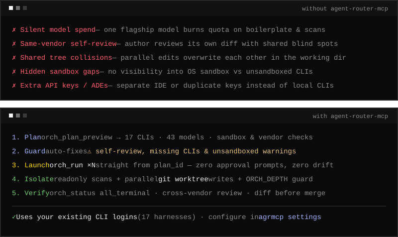
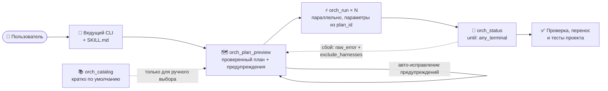

<div align="center">

<br><br>

     <br>
    <br><br>

<a href="README.md">🇬🇧 English</a> · <a href="README.ru.md">🇷🇺 Русский</a> · <a href="README.zh.md">🇨🇳 中文</a>

</div>

# 🧭 agent-router-mcp

> **Универсальный локальный MCP-оркестратор моделей для любых IDE и самостоятельных CLI** — подключается к любому MCP-клиенту (VS Code, Cursor, Windsurf, Zed, JetBrains, Claude Desktop, Antigravity или терминальные CLI) и раздаёт подзадачи между **17 кодинговыми CLI-харнессами**:                  с автономным запуском по проверенному плану, изоляцией в git worktree и локальным визуальным UI настроек.

`agent-router-mcp` — самостоятельный `stdio` MCP-сервер, **не привязанный ни к одной конкретной IDE или оболочке**. Он объединяет двухслойный TOML-каталог (**17 харнессов, 43 модели от 12 лабораторий, 24 алиаса, 23 канонические роли, 8 пресетов**) с кросс-CLI скиллом. Вместо того чтобы запихивать всю задачу в одну модель или тихо плодить субагентов, твоя IDE или CLI строит одну проверенную таблицу плана — модель, effort, режим, изоляцию, цену, гарантию песочницы и предупреждения — и сразу запускает подзадачи параллельно, не отвлекая тебя вопросами о подтверждении. Пауза бывает, только если ты сам попросил сначала показать план или сделать пробный прогон.

> [!NOTE]
> `agent-router-mcp` **сам не ходит в сеть** и не патчит CLI-бинарники. Он запускает уже установленные и залогиненные на машине CLI, наследуя твоё окружение, прокси и локальные CA-сертификаты. Кастомные харнессы и дополнительные профили добавляются локально через `agrmcp settings` или `~/.config/orchestrator-mcp/models.toml`.

> [!TIP]
> **Пусть установкой займётся твой агент.** Любой AI-агент для кода (Claude Code, Codex, Gemini, Cursor и другие) может сам установить, настроить или доработать проект под тебя: просто укажи ему на [`AGENTS.md`](AGENTS.md) и [`docs/AI_AGENT_GUIDE.md`](docs/AI_AGENT_GUIDE.md) — там пошаговые сценарии с точными командами и проверками.

## ✨ Возможности

| Возможность | Что это значит |
|---|---|
| 🧩 **17 встроенных CLI-харнессов** | `claude`, `codex`, `dsh`, `pi`, `antigravity`, `opencode`, `gemini`, `cursor`, `grok`, `kiro`, `fx`, `muse`, `copilot`, `droid`, `qwen`, `kimi` и `vibe` — плюс свои локальные харнессы в конфиге |
| 🔍 **Автоматическое обнаружение моделей** | `agrmcp models discover` (и **Найти модели** в UI настроек) показывает модели, которые уже знают установленные CLI — офлайн из их собственных файлов конфигурации и кэша либо по запросу через команды перечисления без расхода токенов — и импортирует выбранные как карточки для проверки; `agrmcp doctor` выводит подсказку об офлайн-поиске, когда найдены ненастроенные модели |
| 🚀 **Настройка одной командой** | `agrmcp setup --target all` регистрирует MCP-сервер **и** ставит скилл `orchestrate` во все CLI, найденные на этой машине, после чего перечитывает оба конфига для проверки; `agrmcp mcp install \| status \| uninstall` управляет только записями MCP, а `agrmcp doctor` сообщает о расхождении «скилл установлен, MCP отсутствует» |
| 🔌 **Любые IDE и самостоятельные CLI** | Стандартный `stdio` MCP-сервер — подключается к VS Code, Cursor, Windsurf, Zed, JetBrains, Claude Desktop или прямо к терминальным CLI |
| ⚡ **Автономный запуск по проверенному плану** | `orch_plan_preview` строит и проверяет план (кросс-вендорное ревью, изоляция worktree, проверка песочниц); затем агент сразу запускает параллельные `orch_run` без запросов подтверждения |
| 🔒 **Только по явной просьбе** | оркестратор никогда не включается сам — инструменты `orch_*` запускаются, только если ты прямо попросил оркестрацию (оркестратор, мультимодельная маршрутизация, swarm, `/orchestrate`); после просьбы работает автономно, без запросов подтверждения запуска |
| 🏎️ **Быстрая работа с MCP** | встроенные `instructions` MCP-сервера, компактный `orch_catalog` (по умолчанию `detail: "brief"`), автоподстановка параметров `orch_run` из `plan_id` + `subtask_id` и событийное ожидание `orch_status` с курсором продолжения и прогрессом |
| 🔁 **Точные ошибки и умный фейловер** | у упавшей задачи сохраняется точный текст ошибки провайдера без секретов (`raw_error`), классифицированный `code` (`QUOTA_EXCEEDED`, `RATE_LIMITED`, `PROVIDER_OVERLOADED`, `AUTH_REQUIRED`, `MODEL_UNSUPPORTED`, `PROMPT_TOO_LARGE`, …), `failure_scope`, проверенный флаг `safe_to_reroute` и подобранные под роль `suggested_alternatives`; агент сам перенаправляет подзадачу и сообщает об этом |
| 🔗 **Явное продолжение между CLI и автоочистка запусков** | По умолчанию каждый исполнитель начинает с чистого контекста. Укажи `continue_from_job_id` и при необходимости `context_id`, чтобы передать примерно до 12 КБ контекста между всеми 17 CLI, в том числе при переключении на другого вендора, без постоянного состояния сверх обычного каталога запуска задачи. Старые завершённые запуски в `runs/` очищаются автоматически. |
| ⚡ **Параллелизм, шардинг и нативные субагенты** | глобальные значения по умолчанию `max_concurrency = 8` на сессию репозитория (`concurrency_scope`) / `host_max_concurrency = 24` / `max_queue_size = 32`; лимиты на харнесс берутся из собственных конфигов CLI (Linux, macOS, Windows); шардинг на одной модели через `subtasks[].shards` (1–8); неблокирующее планирование по харнессам; управляемые нативные субагенты CLI, которые только понижаются на один запуск |
| ♻️ **Повторы с сохранением прогресса** | прерванные, упавшие по таймауту или иначе задачи сохраняют очищенный от секретов `checkpoint.json` (частичный вывод, след инструментов, изменённые файлы, ограниченный diff); ошибки `TIMEOUT` содержат `has_partial_progress` и готовый вызов `error.resume`, а повтор продолжает с ограниченной передачей «Progress before stop» |
| 🧾 **Мягкая проверка входных данных MCP** | все 6 инструментов принимают `null` в необязательных полях, числа и булевы значения в строках, списки из одного значения или через запятую и алиасы; неизвестные аргументы возвращаются в `ignored_arguments` с подсказкой ближайшего ключа; пропущенные обязательные аргументы дают структурированную ошибку `INVALID_INPUT` с `details.missing` и `details.example` |
| 🌐 **Английский по умолчанию, русский по желанию** | каталог, планировщик, скилл и UI настроек по умолчанию на английском; русский — через `locale: "ru"` (или `[defaults] locale = "ru"`) и сохраняемый переключатель **EN / RU** в UI настроек |
| 🌿 **Изоляция git worktree** | параллельные `write`-подзадачи идут в отдельных worktree внутри `ORCH_STATE_DIR` и не мешают друг другу в рабочей копии |
| 🧠 **Анти-хайп каталог по умолчанию** | 43 модели от 12 лабораторий, 23 роли и 8 универсальных пресетов с честными слабостями, кросс-вендорным ревью, авто-фоллбэком с неустановленных CLI и без ловушки `max` |
| 🎛️ **Настройки в стиле Technical Ledger** | веб-редактор (`agrmcp settings`) без внешних зависимостей: операционные таблицы, текущее состояние harness и готовность к делегированию, матрица пресетов в режиме «список и детали», полный редактор `[defaults]`, боковая панель проверки обнаруженных моделей, поля harness и моделей с учётом драйвера, собственные тематические выпадающие списки, постоянная панель сохранения со статусом, подсказки о правилах сохранения, фавиконка, поиск `/` и строгая офлайн CSP с nonce |
| 🛡️ **Защищённый запуск** | запуск только по argv (без shell), анти-рекурсия `ORCH_DEPTH`, проверка идентичности бинарников (`fx`/`agent`), контроль `readonly`, зачистка групп процессов и внуков, вычистка секретов и лимиты вывода |
| 🧪 **Офлайновый набор тестов** | 2,150 тестов в 47 файлах: все 17 драйверов, интеграция на заглушках CLI, редакторы конфигов `agrmcp setup` / `agrmcp mcp`, параллелизм по сессиям и таймауты с учётом активности, безопасность Web UI, бюджет каталога, примеры TOML, `agrmcp wait`, обнаружение лимитов CLI, обнаружение моделей, карантин конфига, чекпоинты, мягкая проверка входных данных MCP и реальный `stdio` MCP smoke |

## 🎯 Что решает

Маршрутизация сложных инженерных задач между профильными CLI-агентами без потери контроля над ценой, песочницами и правками файлов:

<div align="center">

<br><sub>Иллюстрация рабочего цикла и результата, а не буквальный скриншот.</sub>
</div>

| ✅ Решает | ❌ Не решает |
|---|---|
| подбор модели, CLI и effort под каждую роль с прозрачной ценой и заметками о слабостях | не является LLM API-шлюзом или прокси — по-прежнему нужны свои локальные CLI и авторизация |
| изоляцию параллельных `write`-субагентов в отдельных git worktree | не мержит диффы worktree за твоей спиной — ведущий агент проверяет, переносит и тестирует их сам |
| защиту от слепых пятен одного вендора за счёт предупреждений кросс-вендорного ревью | не обходит лимиты, подписки и сбои на стороне провайдеров — только перенаправляет работу в обход них |
| визуальную настройку каталога без правки встроенных дефолтов (разреженный оверлей + сброс) | навязывает проверенный план каждому запуску по умолчанию — скилл всегда сначала делает предпросмотр, но сервер требует действительный `plan_id` в `orch_run` только при `require_plan_id = true` (по умолчанию `false`) |
| восстановление после исчерпанной квоты, rate limit, перегрузки и слетевшей авторизации — перенаправлением на исправный харнесс с сохранением точного текста ошибки | не переключается молча — каждое перенаправление явное, проверено планом и попадает в отчёт вместе с исходным `raw_error` |

## 🚀 Установка

Собери пакет один раз, затем запусти `agrmcp setup`, чтобы подключить `stdio` MCP-сервер и поставить сопутствующий скилл в нужные CLI, либо подключи сервер вручную по рецептам ниже. В командах ниже замени `/abs/path/to/agent-router-mcp` на абсолютный путь к репозиторию.

<table>
<tr><td width="260"> <br><sub>Сборка TypeScript и опциональный глобальный link</sub></td><td>

```bash
git clone https://github.com/nazavod777/agent-router-mcp.git && cd agent-router-mcp
npm install
npm run build        # компилирует TypeScript в dist/ и копирует UI настроек
npm link             # необязательно: ставит единственную глобальную команду `agrmcp`
```

</td></tr>
<tr><td width="260"><br><sub><b>Рекомендуется:</b> MCP + скилл одним шагом, с проверкой по каждому CLI</sub></td><td>

```bash
agrmcp setup --target all     # все CLI, найденные на этой машине (или: --target claude, --target gemini, ...)
agrmcp setup --dry-run        # только предпросмотр; --force перезаписывает отключённую или чужую запись "orchestrator"
agrmcp mcp status --check     # код выхода 1 при расхождении (например, скилл есть, а MCP нет)
```

</td></tr>
<tr><td width="260"><br><sub>Вручную: любая IDE / MCP-клиент (VS Code, Cursor, Windsurf, Zed, JetBrains, Claude Desktop)</sub></td><td>

```json
{
  "mcpServers": {
    "orchestrator": {
      "command": "/abs/path/to/node",
      "args": ["/abs/path/to/agent-router-mcp/dist/cli/main.js", "mcp"]
    }
  }
}
```

</td></tr>
<tr><td width="260"><br><sub>Вручную: Claude Code (<code>-s user</code> = все проекты; без него только текущий проект)</sub></td><td>

```bash
claude mcp add -s user orchestrator -- "$(command -v node)" "/abs/path/to/agent-router-mcp/dist/cli/main.js" mcp
```

</td></tr>
<tr><td width="260"><br><sub>Вручную: Codex CLI</sub></td><td>

```bash
codex mcp add orchestrator -- "$(command -v node)" "/abs/path/to/agent-router-mcp/dist/cli/main.js" mcp
```

</td></tr>
<tr><td width="260"> <br><sub>Вручную: Antigravity или Gemini CLI (<code>--scope user</code> = все проекты)</sub></td><td>

```bash
# Antigravity читает ~/.gemini/config/mcp_config.json (устаревший путь: ~/.gemini/antigravity/mcp_config.json)
agy mcp add orchestrator -- "$(command -v node)" "/abs/path/to/agent-router-mcp/dist/cli/main.js" mcp
gemini mcp add --scope user orchestrator "$(command -v node)" "/abs/path/to/agent-router-mcp/dist/cli/main.js" mcp
```

</td></tr>
<tr><td width="260"> <br><sub>Вручную: Pi или OpenCode</sub></td><td>

```bash
# В Pi >= 0.99.0 есть встроенный MCP-клиент, читающий ~/.pi/agent/mcp.json
pi mcp add orchestrator -- "$(command -v node)" "/abs/path/to/agent-router-mcp/dist/cli/main.js" mcp
# OpenCode: интерактивно либо правкой opencode.json / opencode.jsonc (комментарии разрешены):
#   V2 -> "mcp": { "servers": { "orchestrator": ... } }    V1 -> "mcp": { "orchestrator": ... }
opencode mcp add
```

</td></tr>
<tr><td width="260"><br><sub>Вручную: добавь в ~/.dsh/cordis.patch.yml</sub></td><td>

```yaml
- insert:
    - id: mcp-orchestrator
      name: '@deepseek-ai/dsh-mcp-client'
      config:
        serverName: orchestrator
        transport: stdio
        command: /abs/path/to/node
        args: [/abs/path/to/agent-router-mcp/dist/cli/main.js, mcp]
```

</td></tr>
<tr><td width="260"><br><sub>Управление записями MCP, скилл и проверка CLI</sub></td><td>

```bash
agrmcp mcp install [--target <cli>|all] [--dry-run] [--force] [--json]  # только запись MCP
agrmcp mcp status [--target <cli>|all] [--check] [--json]               # missing / current / stale / disabled / conflict / invalid
agrmcp mcp uninstall [--target <cli>|all] [--dry-run] [--force]         # удалить только запись orchestrator
agrmcp skill install                 # только скилл: 4 базовых CLI + каждый другой найденный CLI
agrmcp skill install --target gemini # скилл только в один конкретный CLI
agrmcp doctor                        # 17 харнессов + таблица «MCP client registrations»
```

</td></tr>
</table>

> [!TIP]
> `agrmcp setup` и `agrmcp mcp install` всегда записывают абсолютный путь к `node` и к `dist/cli/main.js` этой сборки (атомарная запись с резервной копией прежнего файла), а `--target all` выбирает только CLI, найденные на этой машине; `agrmcp mcp status` показывает `stale`, если запись указывает на другую сборку. Пишешь запись вручную? В GUI-клиентах указывай в `command` абсолютный путь к `node` (`$(command -v node)`; в Windows PowerShell — `(Get-Command node).Source`), потому что они часто не видят `PATH` от nvm/asdf, и никогда не полагайся на голое `node`; VS Code использует ключ верхнего уровня `"servers"`, а Zed — `"context_servers"` вместо `"mcpServers"`. Без `npm link` везде, где в README написано `agrmcp`, запускай `node "/abs/path/to/agent-router-mcp/dist/cli/main.js"` (например `node "/abs/path/to/agent-router-mcp/dist/cli/main.js" doctor`). После `npm link` вместо `node "/abs/path/to/agent-router-mcp/dist/cli/main.js" mcp` можно писать просто `agrmcp mcp`. Обновляешься со старого релиза? Старые записи `orchestrator-mcp` / `orch mcp` в существующих конфигах CLI автоматически мигрирует `agrmcp setup` (без `--force`), а `agrmcp doctor` помечает устаревшие глобальные симлинки `orch` / `orchestrator-mcp` / `orchestrate-settings`, чтобы ты их удалил. Обновление: `git pull && npm install && npm run build && npm link`, затем `agrmcp setup --target all && agrmcp mcp status --check` и удали симлинки, отмеченные `agrmcp doctor`. Для `dsh` проверяй итоговый конфиг командой `dsh --profile <профиль> --dump-config`. Команда `agrmcp skill install --target all` (она же по умолчанию без `--target`) ставит только скилл и не трогает записи MCP: она всегда пишет в 4 базовых каталога (`claude`, `codex`, `dsh`, `pi`), создавая их при необходимости, и ещё в каждый другой поддерживаемый CLI, найденный на этой машине (его бинарник есть в `PATH` или его собственный каталог конфигов не пуст), поэтому для отсутствующих CLI пустые папки в `$HOME` не появляются. Чтобы получить и запись MCP, и скилл вместе, запусти `agrmcp setup`.

### 📋 Требования

-  **22.12+** и  (TypeScript 5.9, ESM); для запуска тестов контрибьюторам нужен Node.js `>= 22.12` (или `^24` / `>= 26`) из-за Vitest 5
-  нужен для `write`-подзадач в изолированном режиме `worktree`
- Хотя бы один установленный и залогиненный кодинговый CLI из 17 поддерживаемых харнессов ниже
-  основная проверенная ОС (полная зачистка внуков через `/proc` + `ORCH_JOB_CHAIN`);  использует POSIX-группы процессов, а  — `taskkill /T` вместо групп процессов (см. [Ограничения](#%EF%B8%8F-ограничения))

## 🔌 Поддерживаемые харнессы (17 встроенных драйверов)

Единый источник правды: [`src/drivers.ts`](src/drivers.ts). Все 17 харнессов включены по умолчанию в [`defaults/catalog.toml`](defaults/catalog.toml); неустановленные CLI автоматически пропускаются в `orch_plan_preview`, если есть установленная замена.

| Харнесс | Бинарник | Контракт | Readonly | Write | Промпт | Effort | Изоляция MCP |
|---|---|---|---|---|---|---|---|
|  `claude` | `claude` | `verified` | `tool_allowlist` | `tool_allowlist` | stdin | native | flag |
|  `codex` | `codex` | `verified` | `os_sandbox` | `os_sandbox` | stdin | native | config |
|  `dsh` | `dsh` | `verified` | `os_sandbox` | `os_sandbox` | stdin | native | config |
|  `pi` | `pi` | `verified` | `tool_allowlist` | `unsandboxed` | stdin | native | flag |
|  `antigravity` | `agy` | `verified` | `tool_allowlist` | `unsandboxed` | argv | native | none |
|  `opencode` | `opencode` | `verified` | `tool_allowlist` | `unsandboxed` | stdin | variant | config |
|  `gemini` | `gemini` | `verified` | `tool_allowlist` | `unsandboxed` | stdin | none | flag |
|  `cursor` | `cursor-agent` | `experimental` | `tool_allowlist` | `unsandboxed` | argv | none | none |
|  `grok` | `grok` | `experimental` | `tool_allowlist` | `unsandboxed` | argv | none | none |
|  `kiro` | `kiro-cli` | `experimental` | `tool_allowlist` | `unsandboxed` | argv | none | none |
|  `fx` | `fx` | `experimental` | `unsandboxed` *(запрещён)* | `unsandboxed` | argv | native | none |
|  `muse` | `muse` | `experimental` | `tool_allowlist` | `unsandboxed` | файл 0600 | none | none |
|  `copilot` | `copilot` | `experimental` | `tool_allowlist` | `unsandboxed` | argv | none | none |
|  `droid` | `droid` | `experimental` | `tool_allowlist` | `unsandboxed` | файл 0600 | native | none |
|  `qwen` | `qwen` | `experimental` | `tool_allowlist` | `unsandboxed` | stdin | none | flag |
|  `kimi` | `kimi` | `experimental` | `tool_allowlist` | `unsandboxed` | argv | none | none |
|  `vibe` | `vibe` | `experimental` | `tool_allowlist` | `unsandboxed` | argv | none | none |

> [!IMPORTANT]
> **`verified`** означает, что флаги, формат вывода и пробы проверены вживую на реальном CLI-бинарнике под Linux. **`experimental`** означает опору на документированные контракты и офлайновые мок-тесты; `orch_plan_preview` явно предупреждает об этом и отдаёт приоритет `verified`-драйверам при автоподборе. Для `fx` пока нет проверенного readonly-профиля, поэтому `readonly`-задачи на `fx` отклоняются до запуска с `SANDBOX_POLICY_VIOLATION`.

## ⚙️ Как это работает



Полный протокол описан в [`skills/orchestrate/SKILL.md`](skills/orchestrate/SKILL.md):

1. **Быстрый триаж** — простую одношаговую задачу агент делает сам; сложная, многофайловая или критичная к ревью работа идёт через оркестрацию. Большие файлы ведущий агент заранее не читает — их читают исполнители.
2. **`orch_plan_preview`** — для стандартных пресетов вызывается сразу. Раскладывает задачу на подзадачи и возвращает модель, effort, режим (`readonly`/`write`), изоляцию, цену, гарантию песочницы и предупреждения (устаревшие карточки, дорогой `max`, запись без песочницы, экспериментальный адаптер, саморевью тем же вендором). `orch_catalog` нужен только для выбора конкретной модели (по умолчанию `detail: "brief"`; `detail: "full"` — полные карточки моделей и `concurrency` по харнессам, а полные карты ролей пресетов требуют `preset: "<id>"` или `include_preset_roles: true`).
3. **Авто-исправление предупреждений** — саморевью, отсутствующие или неавторизованные харнессы, запись без песочницы и premium-модели агент исправляет сам, не более чем одним повторным превью, и сообщает, что поменял.
4. **Автономный запуск** — все независимые подзадачи стартуют за один ход параллельными `orch_run({ plan_id, subtask_id, prompt, cwd, async: true, client_request_id })`; харнесс, модель, effort, режим и изоляция подставляются из сохранённого плана. Подтверждений не спрашивается — пауза только если ты сам попросил сначала план, пробный прогон или оценку стоимости.
5. **Экономное ожидание** — предпочитай `agrmcp wait --job <id> [--job <id> ...]`, если хост умеет уведомлять о завершении фоновых shell-команд: запускай асинхронные `orch_run` и одну фоновую команду ожидания, затем продолжай работу после уведомления. Иначе вызывай `orch_status({ plan_id, wait_ms: 600000, until: "any_terminal" })`; сервер подстраивает ожидание под таймаут хоста, отправляет `notifications/progress`, если это поддерживается, и возвращает непрозрачный `cursor` в `next.args`; MCP-клиент передаёт `_meta.progressToken` и получает от сервера heartbeat-уведомления `notifications/progress`. Следуй `next.args`, пока `pending_count > 0 || unseen_count > 0`, то есть всякий раз, когда вернулся `next` (в том числе когда завершённые задачи были усечены). Событие завершения будит вызов; близкие завершения могут объединяться примерно 1,5 секунды. Оба варианта обходятся без циклов опроса; для вывода есть `orch_logs`, для отмены — `orch_cancel`.
6. **Точные ошибки и умное перенаправление** — упавшая задача возвращает точный `raw_error`, `code`, `failure_scope`, `safe_to_reroute` и `suggested_alternatives`; агент перестраивает план с `exclude_harnesses` / `exclude_models` и перезапускает подзадачу (не больше 2 перенаправлений на подзадачу, кроме `TIMEOUT`) без вопросов — подробности ниже.
7. **Интеграция** — ведущий агент проверяет выводы, переносит изменения из worktree, прогоняет реальные тесты проекта, удаляет worktree только после интеграции и показывает итоговую таблицу маршрутизации вместе с цепочками фейловера.

**Только по явной просьбе и мультимодельный Design Gate:** скилл и инструкции MCP-сервера включают оркестрацию, только когда ты прямо об этом попросил. Перед крупным изменением внешнего контракта, границы безопасности/песочницы, схемы хранения или логики фейловера/конкурентности агент сначала советуется с 1–2 readonly-советниками других вендоров по полной цепочке `orch_plan_preview({ intent: "design_consult", host_vendor?, ... })` → запуск советников через `orch_run` → ожидание через `orch_status({ plan_id, until: "all_terminal" })` → синтез их ответов и фиксация решения до написания кода. Локальные обратимые правки этот шаг пропускают.

### 🔁 Точные ошибки и умный фейловер

Если задача упала или вышла по таймауту, `orch_status` и `orch_run` возвращают структурированный `error`, а не размытое «failed»:

| Поле | Что означает |
|---|---|
| `code` | классифицированная причина: `QUOTA_EXCEEDED`, `RATE_LIMITED`, `PROVIDER_OVERLOADED`, `AUTH_REQUIRED`, `MODEL_UNSUPPORTED`, `CLI_NOT_FOUND`, `HARNESS_UNAVAILABLE`, `PROMPT_TOO_LARGE`, `TIMEOUT`, `NON_ZERO_EXIT`, `PARSE_ERROR`, … |
| `raw_error` / `stderr_tail` | точный текст ошибки CLI или провайдера; секреты вычищены, но в `orch_status` текст никогда не скрывается; `orch_status` обрезает `raw_error` до 1 500 байт (полный сохранённый вывод — в `orch_logs`) |
| `failure_scope` | `harness` (весь аккаунт или CLI: квота, авторизация, rate limit, перегрузка), `model` (только эта модель) или `job` (только этот запуск) |
| `safe_to_reroute` | `true`, если перезапуск не затрёт частичные правки и ни один процесс не мог остаться запущенным: обычно `true` для `readonly` и `worktree`, но при неудачном завершении дерева процессов возвращается `false` и там; для записи в `shared` — проверяется сравнением состояния git-дерева до и после задачи |
| `suggested_alternatives` | ранжированные замены под ту же роль на исправных харнессах (никогда для `TIMEOUT`); при ошибке уровня `harness` упавший харнесс исключается, правила песочниц и кросс-вендорное ревью сохраняются |

**Кулдауны на сессию:** харнесс с `QUOTA_EXCEEDED`, `AUTH_REQUIRED` или `CLI_NOT_FOUND` отдыхает 10 минут; с `RATE_LIMITED` или `PROVIDER_OVERLOADED` — 2 минуты; модель с `MODEL_UNSUPPORTED` — 10 минут. Пока кулдаун действует, `orch_plan_preview` с предупреждением обходит деградировавший харнесс или модель; кулдаун снимается при следующем успехе или с `refresh_health: true`. Исключить можно и явно — через `exclude_harnesses` и `exclude_models`:

```js
orch_plan_preview({ cwd, subtasks, exclude_harnesses: ["codex"] })  // после QUOTA_EXCEEDED на codex
```

Скилл-компаньон по этим полям восстанавливается сам (не больше 2 перенаправлений на подзадачу). Перед любым перенаправлением он всегда проверяет `safe_to_reroute: true`, даже в `readonly` и `worktree`, потому что при неудачном завершении дерева процессов и там возвращается `safe_to_reroute: false`. При `safe_to_reroute: false` он останавливает эту подзадачу и сообщает пользователю: он никогда не перенаправляет её на другой харнесс и не запускает второго параллельного писателя в том же чекауте, потому что после неподтверждённого завершения дерева процессов старый процесс ещё может писать; итоговый отчёт перечисляет каждую цепочку фейловера с исходным `raw_error`.

**Когда остановиться и как разбирать таймаут:** при `DELEGATION_UNAVAILABLE`, `launchable: false`, `delegation_status: "exhausted"` или `delegation_state: exhausted` немедленно прекрати работу и сообщи пользователю. Не выполняй заблокированные подзадачи сам и не переключай исполнителя молча. При `TIMEOUT` сначала проверь предупреждения о завершении процессов: если завершить процессы не удалось (`safe_to_reroute: false`, нет `error.resume`), не возобновляй вслепую в испорченный чекаут; иначе отправь `orch_run(error.resume.args)` как есть (там есть `plan_id` и `subtask_id` для развёртываний с `require_plan_id = true`) на той же модели и действуй по `error.timeout_kind`: `soft` допускает больший `timeout_sec`, `idle` (CLI завис) требует проверить `error.stderr_tail`, авторизацию и квоту и продолжить без увеличения `timeout_sec`, а `hard` (достигнут предел) — разделить задачу для этой модели. Между моделями передавай задания только на английском, а пользователю отвечай на его языке.

Таймаут задачи по умолчанию составляет 900 секунд, а для уровней усилия `high`, `xhigh` и `max` — 1800 секунд; не передавай `timeout_sec` и дай серверу выбрать значение. **Защита от таймаута с учётом активности:** при `auto_extend_timeout = true` (по умолчанию) потоковая задача, которая выдала вывод, stderr или нагрузку на CPU за последние `activity_window_sec = 180` секунд, получает сдвиг мягкого дедлайна на `timeout_extension_sec = 600` секунд — многократно, вплоть до предела `max_timeout_sec` в 3600 секунд; потоковая задача без активности `idle_timeout_sec = 900` секунд останавливается раньше как зависшая (`0` отключает контроль простоя); а `strict_timeout: true` отключает продление для жёсткого лимита по времени.

### ⚡ Параллелизм, шардинг и нативные субагенты

- **Глобальные лимиты (параллелизм по сессиям):** `max_concurrency = 8` одновременных задач на сессию; `concurrency_scope` задаёт, что считать сессией: `repo` (по умолчанию; один репозиторий, worktree-ы относятся к основному репозиторию), `context` (один `context_id`) или `global` (весь хост). `host_max_concurrency = 24` — потолок на все сессии (эффективный лимит `max(host_max_concurrency, max_concurrency)`), по умолчанию `max_queue_size = 32` задач в очереди; `QUEUE_FULL` содержит `details.scope` (`session` или `host`); `orch_max_depth` остаётся `1`.
- **Обнаружение лимитов CLI:** `src/config/cli-limits.ts` читает реальные настройки параллелизма и глубины из локальных конфигов CLI на Linux, macOS и Windows: Codex `config.toml`, Claude `settings.json` и управляемые настройки, OpenCode `opencode.json`/`opencode.jsonc`, профили DSH и `cordis.patch.yml`, а также Gemini/Pi `settings.json`. Только если CLI не задаёт лимит, харнесс использует запасное значение `default_harness_concurrency = 5`; `harnesses.<id>.max_concurrency` переопределяет оба варианта. Итоговый лимит харнесса: `min(max_concurrency, override ?? лимит CLI ?? default_harness_concurrency)`.
- **Шардинг на одной модели:** раздели одну подзадачу через `subtasks[].shards` или запланируй несколько подзадач на одной модели — в пределах `effective_cap` этого харнесса. `shards: 1` равносильно отсутствию `shards` (для изолированной одиночной записи передай явный `isolation: "worktree"`); `shards: 2..8` разворачивается в `<id>#1..<id>#N` и для записи принудительно включает `isolation: "worktree"`. Шарды `readonly` делят рабочее дерево. Планирование неблокирующее по харнессам: перегруженный харнесс не задерживает свободный.
- **Управляемые нативные субагенты:** `native_subagents` (`"cli_limit"` или `"off"`, по умолчанию `"cli_limit"`) и `native_subagent_depth` (0–3, по умолчанию `2`) только понижают собственные лимиты субагентов CLI на время одного запуска. Ограничение реально применяют `claude`, `codex`, `opencode` и `dsh` (`pi` и так отключает расширения через `--no-extensions`); у остальных CLI (например `gemini` и экспериментальных драйверов) нет флага для отдельного запуска, и они сообщают `unknown` с предупреждением. Пользовательские конфиги CLI не изменяются, а глобальный `inherit_mcp` не включается.
- **Где смотреть:** `orch_catalog` (по каждому харнессу), `orch_plan_preview` (`plan.concurrency`) и `agrmcp doctor` (`--json` и таблица).

### ♻️ Повторы с сохранением прогресса

- **Потоковый вывод Claude:** `claude` запускается с `--output-format stream-json --verbose` (по-прежнему с `--no-session-persistence`), поэтому частичный прогресс виден в реальном времени; тела `tool_result` вырезаются из `stdout.log`.
- **Чекпоинт:** прерванная, упавшая по таймауту или иначе задача записывает очищенный от секретов `checkpoint.json` с правами `0600`: частичный ответ ассистента, компактный след вызовов инструментов, изменённые файлы и ограниченный фрагмент diff (из worktree задачи или в рамках записи в `shared`). Читается через `orch_logs({ job_id, part: "checkpoint" })`.
- **Возобновление:** ошибки `TIMEOUT` содержат `has_partial_progress` и, если дерево процессов завершилось чисто, готовый вызов `error.resume` (используй `error.resume.args` как есть; сначала проверь предупреждения о завершении процессов). При продолжении через `continue_from_job_id` (или автоматически при повторном запуске `plan_id` + `subtask_id` после таймаута; `fresh: true` отключает это) к промпту добавляется ограниченная передача «Progress before stop» объёмом до 16 КБ, а чистый worktree используется повторно — повтор продолжает с того места, где остановился исполнитель.

## 🎛️ Визуальный UI настроек

Запусти `agrmcp settings [--no-open] [--port N]`, чтобы открыть локальную панель Technical Ledger. Она работает на Node `http` и загружает все ресурсы локально.

| Вкладка | Что настраивается |
|---|---|
| 🤖 **Модели** | Поиск клавишей `/` или `Ctrl+K`, фильтры по harness и уровню, редактирование карточек (включая `vendor_family`, с выведенным вендором в подсказке), сброс поля или всей модели, добавление своих моделей; **Найти модели** для проверки и импорта моделей, о которых сообщают ваши CLI |
| 🔌 **Харнессы** | Операционные таблицы с текущим состоянием harness и готовностью к делегированию; статус установки, версии, входа, контракта и песочницы; добавление своих harness; редактирование `extra_args` по одному аргументу в строке, `inherit_mcp` в трёх состояниях, `max_concurrency` и `model_discovery`; поля, которые драйвер не читает, скрываются или помечаются |
| 📋 **Пресеты** | Режим «список и детали»: матрица ролей → harness → модели → effort для всех 23 ролей с автоматической фильтрацией совместимых вариантов |
| 🛡️ **Лимиты и безопасность** | Полный редактор `[defaults]` с группами настроек, проверкой значений и сбросом отдельных полей |

Выпадающие списки — собственные тематические элементы, редактор `[defaults]` держит постоянную панель сохранения с живым статусом, на страницах есть подсказки о правилах сохранения (переключатели сохраняются сразу; записи сохраняются из своего редактора), а у интерфейса есть собственная фавиконка. Интерфейс по умолчанию на английском; переключатель **EN / RU** в боковой панели включает русский и запоминает выбор. Горячие клавиши: `/` или `Ctrl+K` переводит фокус в поиск моделей; `Alt+1`–`Alt+4` переключает разделы; `Ctrl+S` сохраняет открытую форму; `Esc` закрывает панель или мобильную навигацию. Строгая офлайн Content Security Policy (CSP) разрешает только скрипты и стили с одноразовым nonce текущего ответа и блокирует внешние ресурсы.

Конфигурация построена по **двухслойной схеме разреженных переопределений**:

1. **Встроенный каталог** — [`defaults/catalog.toml`](defaults/catalog.toml), обновляется вместе с пакетом и руками не правится.
2. **Пользовательские правки** — `~/.config/orchestrator-mcp/models.toml` (или `$XDG_CONFIG_HOME/orchestrator-mcp/models.toml`), пишется с правами `0600` и хранит **только отличия** от дефолта. Если встроенная карточка потом изменится, UI покажет пометку **«дефолт обновился»** рядом с твоей правкой.

Все записи идут под файловой блокировкой и проверкой ревизии (`409 Conflict` вместо перезаписи чужих правок). Битый пользовательский файл не роняет MCP-сервер: если один харнесс, модель, пресет или алиас задан некорректно или конфликтует с остальными, в карантин попадает только этот объект (он перечисляется в `quarantined` и `config_warnings` с причиной, очищенной от секретов, и показывается баннером в UI), а все остальные переопределения продолжают применяться и остаются доступными для редактирования. Откат к последнему валидному конфигу или встроенному каталогу с предупреждением происходит только для файла, который вообще не разбирается (синтаксис TOML, неизвестный раздел верхнего уровня), или при некорректном значении в `[defaults]`. Полный сброс всегда сохраняет резервную копию `models.toml.bak.<время>`.

**Закрытый при ошибке холодный старт (`cold_start_fallback`):** если при запуске MCP-сервера `models.toml` повреждён и в памяти нет более раннего валидного конфига, сервер сообщает `cold_start_fallback: true` и отказывается запускать задачи с ошибкой `CONFIG_INVALID`, а не работает с ослабленными значениями по умолчанию; почини файл (`agrmcp config show --json` покажет `config_warnings`) или сбрось его — запуски возобновятся. У каждого объекта в карантине есть своя кнопка **Reset** в баннере UI (в консоли — `agrmcp config reset <цель>`). **Область блокировки:** файл блокировки защищает от одновременной записи несколькими процессами `agrmcp` (CLI и Settings UI); ручная правка в редакторе блокировку не берёт, и её ловит проверка ревизии прямо перед атомарным переименованием, после чего возвращается `409 Conflict`. **Windows:** `0600` — это право POSIX; в Windows держи каталоги конфигурации и состояния внутри личного профиля пользователя (например, в `%USERPROFILE%` или `%LOCALAPPDATA%`), а не в общей папке, потому что NTFS не обеспечивает `0600`.

### Кастомные харнессы и модели

Свои CLI-обёртки или альтернативные профили поверх любого из 17 драйверов добавляются локально через **Харнессы → + Добавить харнесс** и **Модели → + Добавить модель** в `agrmcp settings` (или напрямую в `~/.config/orchestrator-mcp/models.toml` с `custom = true`), а отдельные параметры легко менять из терминала:

```bash
# поменять одну роль в пресете
agrmcp config set presets.balanced.roles.quick.effort medium

# выключить модель, которой нет на машине — пресеты подберут замену по каталогу
agrmcp config set models.pi-grok-4.7.enabled false

# ID с точками, слешами или двоеточиями: возьмите сегмент ID в кавычки или используйте --section/--id/--field
agrmcp config get 'models."pi-grok-4.7".tier'
agrmcp config set --section models --id pi-grok-4.7 --field enabled true

# короткий алиас для ID модели и сброс одного поля харнесса
agrmcp config set aliases.fast claude-haiku-5-5
agrmcp config reset harnesses.codex.max_concurrency
```

- **ID:** новые ID харнессов, моделей, пресетов и алиасов начинаются с буквы или цифры и могут содержать буквы, цифры, `.`, `_`, `-`, `/`, `:` и `@` (не более 128 символов; без `..`, `//` или завершающего `/`). Установка неизвестного ID целым JSON-объектом создаёт новый пользовательский элемент.
- **Алиасы:** `agrmcp config set aliases.<alias> <model-id>` и `agrmcp config reset aliases.<alias>`; реальный ID модели всегда побеждает алиас с тем же именем (затенённый алиас получает предупреждение).
- **`inherit_mcp` на харнессе имеет 3 состояния:** не задано (следовать `defaults.inherit_mcp`), `true` или `false`. Встроенные харнессы больше не фиксируют `false`, поэтому изменение `defaults.inherit_mcp` действует и на них. Чтобы очистить унаследованное необязательное поле, используйте `_unset`, например `agrmcp config set harnesses.<id>._unset '["inherit_mcp"]'`.
- **`model_discovery`** на харнессе: `native` (CLI сам перечисляет свои модели), `wrapper` (у скрипта-обёртки можно запросить список моделей) или `manual` (никогда не опрашивается). По умолчанию: `native` для встроенных бинарников, `manual` для пользовательских обёрток и бинарников, заданных путём.
- **Проверки с учётом драйвера:** `agrmcp doctor` предупреждает о полях, которые драйвер никогда не читает (например, `profile` вне `codex`/`dsh`), и о моделях OpenCode без провайдера (`cli_provider` или `cli_model` вида `provider/model`). Вывод вендора для кросс-вендорного ревью понимает CLI-агрегаторы (включая `default_upstream_provider` у Pi), а планировщик при равном соответствии предпочитает курируемые или проверенные карточки автоматически сгенерированным.

### Автоматическое обнаружение моделей

```bash
agrmcp models discover                      # предпросмотр: все включённые харнессы, CLI и локальные файлы; ничего не записывается
agrmcp models discover --offline            # только локальные файлы конфига/кэша; CLI не запускаются
agrmcp models discover --harness opencode --json
agrmcp models discover --apply --select <key>[,<key>...] --revision <rev>
agrmcp models discover --apply --all-new --revision <rev>   # каждая новая модель, не более 50 за вызов
```

- **Офлайн-слой:** читает собственные локальные файлы конфига и кэша каждого CLI (только разрешённые поля моделей, никогда файлы с учётными данными); без подпроцессов и сети. `agrmcp doctor` запускает его в пределах бюджета 45 мс и выводит `Discovery hint: N unconfigured models detected locally` (`discovery_hints` в `--json`).
- **Слой по запросу:** запускает фиксированные команды перечисления, которые не стартуют сессию LLM и не тратят токены (например, `opencode models`, `pi --no-extensions --no-mcp --no-approve --offline --list-models`, `gemini models list` — только если `gemini --help` её объявляет), с окружением из белого списка, 5 с на пробу, 15 с суммарно, не более 2 проб одновременно, ограниченным выводом, очисткой дерева процессов и вычисткой секретов и учётных данных из URL. `extra_args` никогда не добавляются.
- **Проверка:** кандидаты бывают `new` (импортируется как новая карточка), `disabled_in_catalog` (выбор повторно включает единственную существующую отключённую карточку), `ambiguous` (подходят несколько отключённых карточек; ничего не меняется) или `already_configured`; сначала показываются те, которые можно импортировать. `--all-new` импортирует только `new`-модели; используйте `--select` (несовместим с `--all-new`), чтобы повторно включить отключённую карточку. Импортированные карточки помечаются `source = "discovered"` и `metadata_quality = "template"` (скопировано с подходящей встроенной карточки) или `"baseline"` (общая карточка для проверки). `--revision` заставляет `--apply` завершиться ошибкой, если конфиг изменился после предпросмотра. `--all` также перечисляет модели от провайдеров, которые CLI сообщает как не подключённые.

В **UI настроек** кнопка **Найти модели** (в заголовке «Модели» и в каждой сохранённой панели харнесса) открывает панель проверки с переключателем режима On-demand / Offline, выбором харнесса, диагностикой по каждому харнессу, фильтрами поиска и статуса/провайдера и чекбоксами для до 50 моделей, которые импортируются одним атомарным пакетом.

## 🧠 Каталог по умолчанию

Встроенные карточки проверены на `2026-11-25` (`checked_at`). Через `stale_after_days = 90` превью плана начнёт помечать устаревшие карточки автоматически.

### 43 модели от 12 лабораторий на 17 харнессах

| Лаборатория / Платформа | Харнессы | Модели |
|---|---|---|
| Anthropic |  | `claude-opus-5-5`, `claude-sonnet-5-5`, `claude-fable-5-2`, `claude-haiku-5-5` |
| OpenAI |  | `gpt-6.2-astra`, `gpt-6.2-sol`, `gpt-6.1-terra`, `gpt-6-luna` |
| Google Gemini |    | `agy-gemini-4-neon`, `agy-gemini-4-argon`, `agy-gemini-3.8-flash`, `gemini-cli-4-argon`, `gemini-cli-3.8-flash`, `pi-gemini-4-argon` |
| DeepSeek |   | `deepseek-flash` (V4.1 Flash 1017), `deepseek-v4-pro`, `pi-deepseek-v4.1-flash`, `pi-deepseek-v4-pro` |
| Zhipu GLM |  | `pi-glm-5.3`, `pi-glm-5.3-flash`, `pi-glm-5.3-highspeed` |
| Moonshot Kimi |   | `kimi-cli-k3.1-pro`, `pi-kimi-k3.1-pro`, `pi-kimi-k2.7-code`, `pi-kimi-k3` |
| Alibaba Qwen |   | `qwen-cli-3.8-max`, `pi-qwen4-max`, `pi-qwen3.8-max`, `pi-qwen3.8-flash` |
| MiniMax |  | `pi-minimax-m3.1-flash`, `pi-minimax-m3` |
| Xiaomi MiMo |  | `pi-mimo-v2.6-pro`, `pi-mimo-v2.6-flash` |
| xAI Grok |   | `grok-build-4.7`, `pi-grok-4.7` |
| Meta / Mistral |   | `muse-spark-1.3`, `vibe-devstral` |
| Мульти-провайдерные CLI |       | `opencode-default`, `cursor-auto`, `kiro-default`, `fx-default`, `copilot-default`, `droid-default` |

24 коротких алиаса (`gpt-sol`, `claude-fable`, `agy-neon`, `grok-build`, `muse-spark`, `kimi-k3.1-pro` и др.) ведут на полные ID. В каждой карточке записаны и сильные стороны, и **честные слабости**.

### Почему каталог именно такой — анти-хайп принципы

- **Ловушка `max`:** на `max` модели сжигают в разы больше токенов без заметного выигрыша к `high`/`xhigh` (Opus 5.5 — ~173K выходных токенов на задачу, Sonnet 5.5 — ~$10 на задачу). **Ни один пресет не ставит `max` по умолчанию** — вручную выбрать можно, но превью предупредит о цене.
- **Харнесс важнее громкого имени:** модели оцениваются в той CLI-обёртке, в которой реально запускаются. Grok 4.7 набирает 37.6% на Terminal-Bench 4 в своём Grok Build (`grok-build-4.7`), но 24–29% в нейтральных харнессах (`pi-grok-4.7`), где ограничен быстрой readonly-разведкой на `low`.
- **Реальная работа в терминале вместо забитых до потолка рейтингов:** опора на независимые агентные прогоны (Vals и Snorkel Terminal-Bench, SWE-Atlas, FrontierSWE) показала, что свежий DeepSeek V4.1 Flash обходит V4 Pro, а дешёвый GPT-6.2 Sol в терминале почти догоняет Astra вчетверо дешевле.
- **Известные провалы учтены в маршрутах:** Sol теряет факты на вопросах по кодовой базе (−14 п. на SWE-Atlas-QnA), поэтому его нет на `codebase_qa`/`research`; Fable 5.2 пропускает мелочи на ревью, поэтому не стоит на `review`; Gemini 4 Argon реже всех галлюцинирует (4.3%), поэтому стоит на исследовании и визуальном ревью.
- **Кросс-вендорное ревью:** код от Claude проверяет Codex и наоборот — явное поле `vendor_family` и динамический вывод вендора ловят саморевью даже между разными харнессами (например, `antigravity`, `gemini` и `pi-gemini` — одна семья `google`).

### 23 канонические роли

Источник правды: [`src/roles/registry.ts`](src/roles/registry.ts). Каждая роль задаёт режим по умолчанию (`readonly` или `write`), который можно переопределить для конкретной подзадачи в плане.

| Режим по умолчанию | Роли |
|---|---|
| 🔎 `readonly` (13) | `architecture`, `research`, `codebase_qa`, `repo_recon`, `ui_review`, `root_cause`, `review`, `second_opinion`, `security`, `test_strategy`, `performance`, `data_sql`, `long_context` |
| ✏️ `write` (10) | `implementation`, `frontend`, `ui`, `ui_design`, `deep_refactor`, `debugging`, `testing`, `devops`, `writing`, `quick` |

### 8 готовых пресетов

| Пресет | Когда брать | Основа |
|---|---|---|
| `balanced` *(по умолчанию)* | Повседневная разработка | Opus — архитектура, Sonnet — реализация, Fable — UI, Sol/Astra — ревью и безопасность, DeepSeek Flash — разведка, Kimi K3.1 Pro — длинный контекст, Gemini Argon — факты и визуальное ревью |
| `max-quality` | Цена ошибки выше цены токенов | Fable и Opus на `high`, Astra и Sol на `xhigh`, строгое кросс-вендорное ревью |
| `budget` | Максимум результата на доллар | DeepSeek Flash и V4 Pro, Kimi K2.7 Code, GLM-5.3, Qwen 3.8 Flash, MiniMax M3.1 Flash, MiMo v2.6 Pro |
| `open-weights` | Без западных проприетарных моделей | DeepSeek, Kimi, GLM, Qwen 3.8, MiniMax, MiMo |
| `ui-sprint` | Интерфейс и фронтенд | Fable — дизайн и UI, Sol — фронтенд-код, Gemini Argon — ревью по скриншотам, Qwen4 Max — второе мнение |
| `security-audit` | Защитный аудит безопасности | Opus и Astra (`xhigh`) проверяют друг друга, GLM-5.3 — второе мнение, Grok 4.7 (`low`) — быстрая разведка |
| `deep-refactor` | Крупные многофайловые миграции | Fable (`high`) пишет, Kimi K3.1 Pro держит карту репозитория, Astra и Sol (`xhigh`), Astra — ревью |
| `fast-sprint` | Минимальная задержка | Sonnet и Sol (`medium`), Haiku, Terra, DeepSeek Flash, GLM-5.3 Highspeed, MiniMax M3.1 Flash |

> [!IMPORTANT]
> В `budget` и `open-weights` часть ролей идёт через Pi, где режим `write` работает без песочницы (`unsandboxed`). Поэтому `debugging`, `testing` и `devops` в этих пресетах отданы `dsh` с OS-песочницей. Если запись без песочницы недопустима, включи `allow_unsandboxed_write = false` — `orch_plan_preview` сам подберёт безопасную замену.

## 🧰 MCP-инструменты и CLI

### MCP-инструменты (`stdio`)

| Инструмент | Назначение |
|---|---|
| `orch_catalog` | По умолчанию компактный каталог (`detail: "brief"`): харнессы, отфильтрованные/страничные карточки моделей (`offset`/`next_offset`), роли и пресеты; `detail: "full"` добавляет полные карточки моделей и `concurrency` по харнессам; полные карты ролей пресетов требуют `preset: "<id>"` или `include_preset_roles: true`. Для каждого харнесса также показываются эффективный лимит параллелизма и глубина нативных субагентов. |
| `orch_plan_preview` | Строит проверенный план маршрутизации (`plan_id`) с effort, изоляцией, оценкой стоимости, гарантиями песочниц, авто-фоллбэком с неустановленных CLI, предупреждениями и `markdown_table`; `locale: "ru"` — таблица на русском; `exclude_harnesses` / `exclude_models` уводят план от упавших или нежелательных харнессов и моделей (кулдауны сессии применяются автоматически); `intent: "design_consult"` с необязательным `host_vendor` предупреждает, если советники не от других вендоров, — мультимодельный **Design Gate** перед изменением контрактов, безопасности, схем или фейловера. Необязательный `context_id` ограничивает продолжение одним запросом пользователя и автоматически передаётся запускам из плана. `subtasks[].shards` (`1` равносильно отсутствию; `2..8` делит подзадачу на шарды одной модели), а `plan.concurrency` показывает глобальные лимиты и лимиты по харнессам. |
| `orch_run` | Запускает подзадачу из плана (`sync` или `async`) с идемпотентным `client_request_id`; по `plan_id` + `subtask_id` сам подставляет харнесс, модель, effort, режим и изоляцию. Необязательный `continue_from_job_id` продолжает работу предыдущего запуска в той же области контекста: предыдущий запуск должен быть завершён, в том же `cwd`, не позднее 2 часов назад и с тем же `context_id` (или `plan_id`, если его нет). Вызов также принимает `context_id`. `fresh: true` отбрасывает сохранённый прогресс предыдущей попытки, завершившейся таймаутом. `cwd` подставляется из `plan_id` или `continue_from_job_id`, а у продолжения есть детерминированный промпт по умолчанию. |
| `orch_status` | Событийное ожидание (до 600 секунд) или снимок задач по ID или `plan_id`; `until: "any_terminal"`, `"all_terminal"` или `"any_change"`; продолжение по непрозрачному `cursor` из `next.args`, пока `pending_count > 0 \|\| unseen_count > 0`; клиент передаёт `_meta.progressToken` и получает `notifications/progress`, если поддерживается; ошибки содержат `raw_error`, `code`, `failure_scope`, `safe_to_reroute` и `suggested_alternatives` |
| `orch_logs` | Чтение ограниченного вывода задачи: `part` — `summary`, `stdout`, `stderr`, `diff`, `files` или `checkpoint` (частичный вывод, след инструментов и изменённые файлы после прерванной задачи) |
| `orch_cancel` | Остановка активной задачи, всей её группы процессов и отбившихся потомков |

**Мягкая проверка входных данных:** все 6 инструментов принимают `null` в необязательных полях, числа и булевы значения в строках (`"600"`, `"true"`, `"false"`, `"yes"`, `"no"`), строку с одним значением или значениями через запятую для списков и алиас `job_id` в `orch_status`. Неизвестные имена аргументов возвращаются в `ignored_arguments` с подсказкой ближайшего ключа. Пропущенные или пустые обязательные аргументы дают структурированную ошибку `INVALID_INPUT` с `details.missing` и `details.example` вместо непонятного `-32602`. `tools/list` по-прежнему публикует чистую плоскую JSON Schema Draft-7.

### Команды CLI

| Команда | Назначение |
|---|---|
| `agrmcp mcp` | Запуск `stdio` MCP-сервера |
| `agrmcp setup [--target <cli>\|all] [--dry-run] [--force] [--json]` | Настройка одной командой: регистрирует MCP-сервер **и** ставит скилл `orchestrate` для каждой цели (`all` = CLI, найденные на этой машине), затем перечитывает оба результата; цель, которая после запуска не `current` (например, отключённая запись, оставленная без изменений), помечается `verified: false` с `unverified_reason`; код выхода `1`, если какая-либо цель не прошла (ошибка, запись `conflict` или `invalid`) |
| `agrmcp mcp install\|status\|uninstall [--target <cli>\|all] [--dry-run] [--force] [--check] [--json]` | Управление только записью MCP в конфигах 17 CLI; `status --check` завершается кодом `1` при расхождении: любой статус MCP, кроме `current` (отсутствующая, устаревшая, отключённая, конфликтующая или повреждённая запись), либо отсутствующий или устаревший скилл, даже если скилл актуален; `--force` перезаписывает отключённую или чужую запись `orchestrator` |
| `agrmcp settings [--no-open] [--port N]` | Запуск локального визуального UI настроек в браузере |
| `agrmcp doctor [--json]` | Проверка всех 17 харнессов (до 4 проб параллельно): версии, авторизация, контракты, песочницы, лимиты параллелизма и глубины, найденные в собственных конфигах CLI, и состояние конфига (диагностика `config_diagnostics` с учётом драйвера, предупреждения о пользовательских обёртках и офлайн-счётчик ненастроенных моделей `discovery_hints`); также печатает таблицу `MCP client registrations` (`mcp_clients[]` в `--json`) и предупреждает о расхождении, например когда у CLI скилл установлен, а запись MCP отсутствует, отключена или устарела |
| `agrmcp models discover [--harness <id>] [--offline] [--all] [--json]` | Предпросмотр моделей, о которых сообщают установленные CLI или которые они хранят в собственном конфиге (ничего не записывается); добавьте `--apply --select <key>[,<key>...]` или `--apply --all-new` (не более 50 за вызов) и `--revision <rev>`, чтобы импортировать их |
| `agrmcp wait --job <id> [--job <id> ...] [--until any\|all] [--timeout <sec>] [--settle-ms <ms>] [--state-dir <path>]` | Ожидание по событиям ядра через `fs.watch` и запасная проверка раз в 5 секунд; принимает позиционные ID или ID через запятую в `--job`; по умолчанию `any`, таймаут 1800 секунд (максимум 7200) и окно сбора результатов 1500 мс; код выхода `0` — терминальное состояние (`any` или `all`), `2` — таймаут, `130` — отмена (SIGINT/SIGTERM) |
| `agrmcp config path\|show\|get\|set\|reset` | Просмотр, изменение и сброс разреженного пользовательского конфига из терминала; пути с точками могут брать ID в кавычки (`models."<id>".tier`) или использовать `--section <defaults\|harnesses\|models\|presets\|aliases> --id <id> [--field <field>]`; `reset` принимает `aliases`, `aliases.<id>`, `models.<id>.<field>` и `harnesses.<id>.<field>` |
| `agrmcp skill print\|path\|install [--target <cli>\|all] [--dir <путь>]` | Печать или установка `skills/orchestrate/SKILL.md` в каталоги скиллов поддерживаемых CLI |

## 🔐 Модель безопасности

- **`os_sandbox`** (`codex`, `dsh`) — файловая система и выполнение ограничены песочницей ОС.
- **`tool_allowlist`** (`claude`, а также `readonly` в `pi`, `antigravity`, `opencode`, `gemini`, `cursor`, `grok`, `kiro`, `muse`, `copilot`, `droid`, `qwen`, `kimi`, `vibe`) — CLI ограничивает доступные инструменты (например, `OPENCODE_CONFIG_CONTENT` v2 с `* = deny` + `read/grep/glob/list`, приватный `0600`-файл агента для `kimi`, `--mode plan`, `--approval-mode plan`, `--no-mcp`) без ядровой песочницы ОС.
- **`unsandboxed`** — песочницы нет; превью предупреждает об этом, в режиме `readonly` такой запуск всегда блокируется (`fx`), а в `write` его можно полностью запретить флагом `allow_unsandboxed_write = false`.

### Защита выполнения и Web UI

- 🔁 **Анти-рекурсия:** дочерние процессы получают `ORCH_DEPTH` и `ORCH_JOB_ID`; превышение `orch_max_depth` (по умолчанию `1`) сразу отклоняется ошибкой `RECURSION_BLOCKED`.
- 🪪 **Проверка бинарников и argv:** пробы отличают Vercel `fx` от JSON-просмотрщика `antonmedv/fx` и проверяют версию `agent` для Cursor; argv-драйверы ограничивают промпт 100 КиБ (`PROMPT_TOO_LARGE`) и отклоняют `extra_args`, ослабляющие `readonly` (`SANDBOX_POLICY_VIOLATION`).
- ⚙️ **Зачистка дерева процессов:** каждый CLI запускается напрямую через argv (без shell) в собственной группе процессов. В POSIX при отмене, таймауте и штатном завершении группа получает `SIGTERM` → `SIGKILL`; на Linux дополнительно вычищаются отбившиеся внуки через `/proc` по `ORCH_JOB_ID` / `ORCH_JOB_CHAIN`, а macOS опирается на POSIX-группы процессов. В Windows завершение идёт через `taskkill /T` (затем `/T /F`, с запасным `process.kill(pid)`, если `taskkill` недоступен), а не через группы процессов.
- 🌿 **Изоляция путей и сверка плана:** worktree создаются внутри `ORCH_STATE_DIR`; рабочие каталоги проверяются по `ORCH_ALLOWED_ROOTS`; строгий `require_plan_id` (по умолчанию `false`) сверяет параметры запуска и ревизию конфига с действительной строкой `orch_plan_preview`.
- 🌐 **Защищённый localhost Web UI:** слушает только `127.0.0.1` на случайном порту со строгой проверкой `Host` (защита от DNS rebinding); меняет одноразовый токен (действует 5 минут после запуска) на cookie `HttpOnly; SameSite=Strict`; передаёт странице привязанный к origin `X-Orch-Token` только во фрагменте URL одноразового редиректа (`/#t=<token>`: он не уходит по HTTP и никогда не содержится в отдаваемом HTML; страница хранит его в `sessionStorage`, изолированном по origin и порту, и сразу убирает фрагмент из адреса) и требует его вместе с cookie в **каждом** вызове `/api/*`, включая чтение, например `GET /api/state` и `/api/health`; отклоняет любой запрос браузера, у которого `Sec-Fetch-Site` не равен `same-origin`; на запись дополнительно проверяет точный `Origin` + `Content-Type: application/json` + лимит 256 КиБ, а также CSP с nonce и ноль CORS; сам выключается через 15 минут простоя (открытая вкладка шлёт heartbeat).
- 🕶️ **Вычистка секретов:** значения переменных окружения с `KEY`, `TOKEN`, `SECRET`, `PASSWORD` или `CREDENTIAL`, а также `Bearer`-токены и заголовки `Authorization` удаляются из логов, сводок, диффов и ошибок; буквальная вычистка значений окружения срабатывает на секретные значения длиной не менее 8 символов. Конфиг, файлы промптов и бэкапы пишутся с правами `0600`.
- 🛰️ **Прокси и сертификаты:** дочерние CLI наследуют `HTTPS_PROXY`, `NO_PROXY`, `SSL_CERT_FILE` и `NODE_EXTRA_CA_CERTS`.
- 🔍 **Обнаружение моделей только на чтение:** офлайн-читалки открывают только обычные файлы ограниченного размера (симлинк разрешён только на обычный файл, имена файлов с учётными данными отклоняются и для ссылки, и для её цели) и копируют только разрешённые поля моделей; пробы перечисления запускаются без shell под окружением из белого списка (API-ключи, токены, `NODE_OPTIONS`, `LD_*`/`DYLD_*` и переменные прокси отбрасываются), завершаются целым деревом процессов, а секреты и учётные данные в URL вычищаются из их вывода. Обнаружение никогда не выполняется внутри `agrmcp mcp`, `orch_plan_preview` или `orch_run`.

## 🔧 Настройка

| Переменная окружения | По умолчанию | Назначение |
|---|---|---|
| `ORCH_MODELS_PATH` | `~/.config/orchestrator-mcp/models.toml` | Другой путь к файлу разреженных переопределений |
| `ORCH_STATE_DIR` | `~/.local/state/orchestrator-mcp` | Каталог состояния: задачи, ограниченные логи, git worktree, блокировки |
| `ORCH_MAX_DEPTH` | `1` (из `[defaults]`) | Предел глубины вложенной оркестрации; переменная окружения может только ужесточить `orch_max_depth` из конфига, но не повысить его |
| `ORCH_MCP_MAX_WAIT_MS` | из `[defaults].mcp_max_wait_sec` | Максимальное ожидание `orch_status` в миллисекундах; `defaults.mcp_max_wait_sec` по умолчанию `0` (авто), максимум — 600 секунд |
| `ORCH_ALLOWED_ROOTS` | *(не ограничено)* | Список разрешённых рабочих каталогов через разделитель путей платформы (`:` в POSIX, `;` в Windows) |

В разделе `[defaults]` параметр `run_retention_days` задаёт срок хранения (по умолчанию 7 дней), а `max_runs_total_mb` — лимит общего размера (по умолчанию 512 МиБ). Значение `0` отключает соответствующее правило. Автоочистка `runs/` сохраняет активные запуски и все запуски, чьи worktree ещё существуют.

## ⚠️ Ограничения

- 🧪 **Экспериментальные адаптеры (10 драйверов):** `cursor`, `grok`, `kiro`, `fx`, `muse`, `copilot`, `droid`, `qwen`, `kimi` и `vibe` проверены офлайн по документированным контрактам и мок-фикстурам, без живого съёма вывода на этой машине. `aider`, `amp` и `goose` отложены до будущего двустороннего ACP-драйвера.
- 🔒 **Запись без песочницы и запрет readonly:** OS-песочницу на запись дают только `codex` и `dsh`; `claude` работает по `tool_allowlist`; остальные CLI пишут без песочницы ОС (используй `isolation: "worktree"` или `allow_unsandboxed_write = false`). `fx` отклоняет `readonly`, пока не будет проверенного readonly-профиля.
- 📏 **Лимит argv-промпта:** CLI, принимающие промпт только через argv (`antigravity`, `cursor`, `grok`, `kiro`, `fx`, `copilot`, `kimi`, `vibe`), ограничены 100 КиБ (`PROMPT_TOO_LARGE`) из-за Linux `MAX_ARG_STRLEN`; для огромных промптов используй stdin/file-драйверы (`claude`, `codex`, `dsh`, `pi`, `opencode`, `gemini`, `qwen`, `muse`, `droid`).
- 🔁 **Пределы фейловера:** кулдауны действуют только в текущей сессии MCP-сервера; неклассифицированные сбои приходят как `NON_ZERO_EXIT` / `PARSE_ERROR` с точным `raw_error`, и решение принимает агент. Если упали все харнессы, действует правило HARD STOP: прекрати всю основную работу, сохрани незакоммиченные правки и worktree и сообщи пользователю о каждом заблокированном харнессе, дословные ошибки и варианты восстановления.
-  Изолированные worktree стартуют от `HEAD` — незакоммиченные правки из родительской рабочей копии в дочерние worktree намеренно не копируются.
-   Поиск отбившихся процессов-внуков через `/proc` + `ORCH_JOB_CHAIN` работает только на Linux; macOS опирается на POSIX-группы процессов, а Windows использует `taskkill /T` (затем `/T /F`, с запасным `process.kill(pid)`) вместо групп процессов.

## ✅ Статус тестирования

Все тесты полностью офлайновые и используют детерминированные заглушки CLI (сеть и живые API-кредиты не нужны):

```bash
npm run build && npm run typecheck && npm test
```

| Набор | Что проверяет |
|---|---|
| 🧪 **Юнит-тесты** | Двухслойный TOML-резолвер с карантином по каждому объекту, схемы и атомарная запись, политика ID объектов, реестр 23 ролей, вывод вендора, фоллбэк и readonly-защита планировщика и раннера, обнаружение лимитов CLI, обнаружение моделей (читалки, пробы, обогащение) и `agrmcp models`, чекпоинты, мягкая проверка входных данных MCP, редакторы конфигов MCP и скилла, области параллелизма, таймеры дедлайнов |
| 🔌 **Набор адаптеров (17 CLI)** | Все 17 встроенных драйверов: флаги, `readonlyForbiddenArgs`, `PROMPT_TOO_LARGE`, проверки идентичности `fx`/`agent`, JSON/NDJSON парсеры |
| 🔒 **Безопасность Web UI** | DNS rebinding (`Host`), одноразовый токен → cookie, `Origin`/CSRF/`Content-Type`/лимит тела, конфликты 409, динамический `supported_drivers`, бэкапы сброса, предпросмотр и импорт обнаружения моделей с восстановлением после конфликта 409 и истечения срока 410 |
| 📡 **MCP stdio smoke** | Реальный запуск JSON-RPC `stdio`-сервера, `tools/list`, пагинация каталога из 17 харнессов в лимите 24 КБ, `orch_plan_preview`, `orch_run` → `orch_status` |

Офлайновый набор содержит **2,150 тестов в 47 файлах**.

## 🗂️ Структура

| | Путь | Содержимое |
|:---:|---|---|
| 🔌 | `src/drivers.ts` | Единый источник правды для всех 17 `DRIVER_KINDS` и метаданных |
| 📚 | `defaults/catalog.toml` | Встроенный каталог: 17 харнессов, 43 модели, 24 алиаса, 8 пресетов |
| 🧭 | `skills/orchestrate/SKILL.md` | Кросс-CLI протокол быстрой автономной оркестрации |
| 🧩 | `src/adapters/` | 17 CLI-адаптеров (`claude`, `codex`, `dsh`, `pi`, `antigravity`, `opencode`, `gemini`/`qwen`, `vendor-clis`, `ecosystem`), общие парсеры, пул проб |
| ⚙️ | `src/config/` | Разреженный TOML-резолвер с карантином по объектам, Zod-схемы, общая политика ID объектов (`ids.ts`), атомарная запись с блокировкой, кроссплатформенное обнаружение лимитов CLI |
| 🔍 | `src/discovery/` | Обнаружение моделей: офлайн-читалки локальных файлов, пробы перечисления CLI без расхода токенов, санитайзер, обогащение в кандидатов для проверки, сервис предпросмотра и применения |
| 🗺️ | `src/planner/` и `src/roles/` | Реестр 23 ролей, проверка кросс-вендорного ревью, построитель превью плана |
| 🛡️ | `src/runtime/` | Раннер, менеджер worktree, хранилище задач, резолвер параллелизма, чекпоинты, зачистка дерева процессов, редакция секретов |
|  | `src/mcp/` и `src/cli/` | `stdio` MCP-сервер, 6 обработчиков инструментов, единый CLI `agrmcp`, установщик `agrmcp setup` / `agrmcp mcp`, `agrmcp models discover`, мягкая проверка входных данных |
| 🎛️ | `src/settings-ui/` | Защищённый localhost HTTP-сервер и визуальный HTML/JS-редактор без зависимостей |
| 🎨 | [`DESIGN.md`](DESIGN.md) | Визуальные токены, компоновка и правила взаимодействия UI настроек |
| 🧪 | `tests/` | 2,150 офлайновых тестов в 47 файлах (юнит, `agrmcp wait`, примеры TOML, адаптеры, обнаружение моделей, безопасность UI, MCP smoke) |
| 🎨 | `assets/` | SVG для README |
| 🤖 | `AGENTS.md` | Короткие инструкции для AI-агентов: какую задачу они решают, жёсткие ограничения, быстрые сценарии |
| 🤖 | `CLAUDE.md` | Направляет Claude Code к `AGENTS.md` |
| 📖 | `docs/` | `AI_AGENT_GUIDE.md` (пошаговые сценарии P1–P10, решение проблем, шпаргалка по схеме) и проверенные тестами конфиги `examples/*.toml` |

## 🤝 Авторство

| Роль | Кто |
|---|---|
| 👤 **Автор и мейнтейнер** | [**nazavod777**](https://github.com/nazavod777) |
| 🤖 **Инструменты разработки (ИИ)** |  (Anthropic) ·  (OpenAI) ·  (Google) ·  (терминал) |

ИИ-инструменты использовались как помощники в разработке — спасибо их командам. Решения, ревью и ответственность за код — на авторе.

## 📄 Лицензия

[MIT](LICENSE)

---

<div align="center"><sub>Нравится проект? Поддержи автора ☕</sub></div>

<div align="center">

<a href="https://nazavod.dev"></a> <a href="https://t.me/bio_nazavod"></a> <a href="https://github.com/nazavod777"></a> <a href="https://x.com/nazavod777"></a> <a href="https://antidrain.me"></a>

<br><br>
<a href="https://nazavod.dev/coffee/"></a>

</div>
