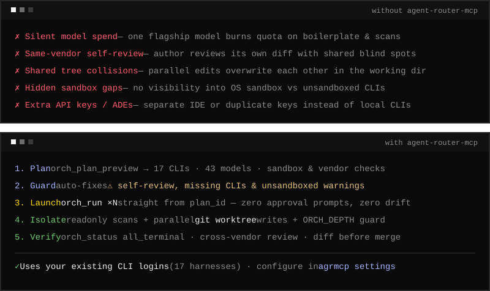
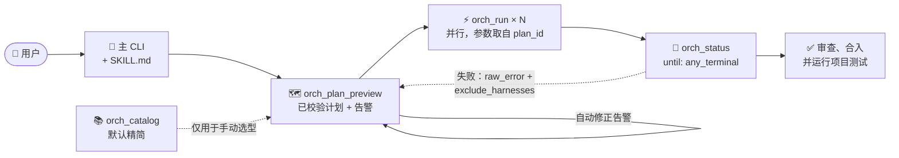

<div align="center">

<br><br>

     <br>
    <br><br>

<a href="README.md">🇬🇧 English</a> · <a href="README.ru.md">🇷🇺 Русский</a> · <a href="README.zh.md">🇨🇳 中文</a>

</div>

# 🧭 agent-router-mcp

> **面向任意 IDE 与独立 CLI 的通用本地 MCP 模型编排器** —— 可接入任何支持 MCP 的客户端（VS Code、Cursor、Windsurf、Zed、JetBrains、Claude Desktop、Antigravity 或终端 CLI），在 **17 个主流编程 CLI Harness** 之间按角色路由子任务：                ，具备基于已校验计划的自主执行、git worktree 隔离与本地可视化设置界面。

`agent-router-mcp` 是完全独立的 `stdio` MCP 服务器，**不绑定任何特定 IDE 或前端界面**。它将精心校准的双层 TOML 模型目录（**17 个 harness、来自 12 家实验室的 43 款模型、24 个别名、23 个标准角色、8 套通用预设**）与跨 CLI 技能相结合。你的 IDE 或终端 CLI 不再把整项任务硬塞进单一模型，也不会静默派生子智能体；它先生成一张经过校验的路由计划表 —— 模型、effort、读写模式、隔离方式、成本、沙箱保障与盲区提示 —— 随后立即并行启动子任务，不会打断你索要确认。只有当你明确要求先看计划或先做演练时才会暂停。

> [!NOTE]
> `agent-router-mcp` 本身**不发起任何外网请求**，也不会修改你的 CLI 二进制文件。它只调用你本机已安装并登录的 CLI，自动继承现有环境变量、代理设置和自定义 CA 证书。自定义 harness 与额外配置均可在本地通过 `agrmcp settings` 或 `~/.config/orchestrator-mcp/models.toml` 添加。

> [!TIP]
> **让你的编程智能体来完成配置。** 任何 AI 编程智能体（Claude Code、Codex、Gemini、Cursor 等）都可以替你安装、配置或定制本项目：只需让它阅读 [`AGENTS.md`](AGENTS.md) 和 [`docs/AI_AGENT_GUIDE.md`](docs/AI_AGENT_GUIDE.md) —— 其中包含带精确命令与校验步骤的分步操作手册。

## ✨ 特性

| 特性 | 说明 |
|---|---|
| 🧩 **17 个内置 CLI Harness** | `claude`、`codex`、`dsh`、`pi`、`antigravity`、`opencode`、`gemini`、`cursor`、`grok`、`kiro`、`fx`、`muse`、`copilot`、`droid`、`qwen`、`kimi`、`vibe`，并支持本地自定义 harness |
| 🔍 **自动发现模型** | `agrmcp models discover`（以及设置界面中的 **发现模型**）列出已安装 CLI 已知的模型——可离线读取其自身的配置/缓存文件，或通过零 token 消耗的 CLI 列表命令按需获取——并将你选择的模型以可审查卡片的形式导入；发现未配置的模型时，`agrmcp doctor` 会输出离线提示 |
| 🚀 **一条命令完成配置** | `agrmcp setup --target all` 为本机检测到的每个 CLI 注册 MCP 服务器**并**安装 `orchestrate` 技能，随后回读两者进行校验；`agrmcp mcp install \| status \| uninstall` 只管理 MCP 条目，`agrmcp doctor` 会标出“技能已安装、MCP 缺失”这类不一致 |
| 🔌 **适配任意 IDE 与独立 CLI** | 标准 `stdio` MCP 服务器 —— 可接入 VS Code、Cursor、Windsurf、Zed、JetBrains、Claude Desktop 或任意独立终端 CLI |
| ⚡ **基于已校验计划的自主执行** | `orch_plan_preview` 构建并校验计划（跨厂商评审、worktree 隔离、沙箱检查）；随后智能体立即并行调用 `orch_run`，全程无需确认提示 |
| 🔒 **严格按需启用** | 编排器绝不会自行启动 —— 只有当你明确要求编排（编排器、多模型路由、swarm、`/orchestrate`）时才会调用 `orch_*` 工具；一旦提出要求，便自主运行，不再弹出启动确认 |
| 🏎️ **高效的 MCP 交互** | 内置 MCP 服务器 `instructions`、默认精简的 `orch_catalog`（默认 `detail: "brief"`）、根据 `plan_id` + `subtask_id` 自动补全 `orch_run` 参数，以及支持游标续读和进度通知的事件驱动 `orch_status` 等待 |
| 🔁 **原样错误与智能故障转移** | 失败任务保留经脱敏的原始提供方错误（`raw_error`）、分类 `code`（`QUOTA_EXCEEDED`、`RATE_LIMITED`、`PROVIDER_OVERLOADED`、`AUTH_REQUIRED`、`MODEL_UNSUPPORTED`、`PROMPT_TOO_LARGE` 等）、`failure_scope`、经校验的 `safe_to_reroute` 标志以及按角色匹配的 `suggested_alternatives`；智能体自主改道并在汇报中说明 |
| 🔗 **显式续接任务与自动清理运行记录** | 执行者默认无状态。显式传入 `continue_from_job_id` 以及可选的 `context_id` 可在全部 17 个 CLI 之间传递最多约 12 KB 的上下文，跨厂商故障转移时也适用，除常规的单任务运行目录外不保留任何持久状态。`runs/` 中较旧的已结束运行记录会按保留规则自动清理。 |
| ⚡ **并行、分片与原生子代理** | 全局默认 `max_concurrency = 8`（按仓库会话计，见 `concurrency_scope`）/ `host_max_concurrency = 24` / `max_queue_size = 32`；按 harness 的并发上限从各 CLI 自身配置中读取（Linux、macOS、Windows）；通过 `subtasks[].shards`（1–8）在同一模型上分片；按 harness 非阻塞调度；受控的 CLI 原生子代理，每次调用只会被调低 |
| ♻️ **保留进度的重试** | 被中断、超时或失败的任务会保存已脱敏的 `checkpoint.json`（部分输出、工具轨迹、变更文件、有界 diff）；`TIMEOUT` 错误带有 `has_partial_progress` 与现成的 `error.resume` 调用，重试时会携带有界的 “Progress before stop” 交接继续执行 |
| 🧾 **宽松的 MCP 入参校验** | 全部 6 个工具都接受可选字段为 `null`、字符串形式的数字/布尔值、单值或逗号分隔的列表以及别名；未知参数会连同最接近的键名提示一起在 `ignored_arguments` 中返回；缺少必填参数时返回结构化的 `INVALID_INPUT`，附带 `details.missing` 与 `details.example` |
| 🌐 **默认英文，可选俄文** | 目录、规划器、技能与设置界面默认使用英文；通过 `locale: "ru"`（或 `[defaults] locale = "ru"`）以及设置界面中可持久保存的 **EN / RU** 切换器启用俄文 |
| 🌿 **Git worktree 隔离** | 并行 `write` 子任务在 `ORCH_STATE_DIR` 下的独立 worktree 中运行，互不覆盖工作区改动 |
| 🧠 **反炒作默认目录** | 12 家实验室 43 款模型、23 个角色、8 套预设，写明真实短板、跨厂商评审机制、未安装 CLI 自动回退并避开 `max` 陷阱 |
| 🎛️ **Technical Ledger 本地设置界面** | 零依赖本地 Web 编辑器（`agrmcp settings`），提供运维表格、实时 harness 健康状态与委派就绪情况、主从详情预设矩阵、完整 `[defaults]` 编辑器、模型发现审查抽屉、感知驱动的 harness 与模型字段、自定义主题下拉菜单、带状态的常驻保存栏、保存规则提示、favicon 图标、`/` 搜索及严格的离线 nonce CSP |
| 🛡️ **受控安全执行** | 纯 argv 启动（无 shell）、`ORCH_DEPTH` 防递归、二进制身份校验（`fx`/`agent`）、严格 `readonly` 校验、进程组与孙进程回收、密钥脱敏以及输出上限保护 |
| 🧪 **全离线测试套件** | 52 个测试文件共 2,685 项测试，覆盖全部 17 个驱动、Windows 进程树 / 沙箱 / 环境变量大小写 / T3 Code 配置档案、模拟 CLI 集成、`agrmcp setup` / `agrmcp mcp` 配置编辑器、按会话并发与基于活动的超时、Web UI 安全、目录字节预算、文档 TOML 示例、`agrmcp wait`、CLI 限制发现、模型发现、配置隔离、检查点、宽松的 MCP 入参校验与真实 `stdio` MCP 冒烟检查 |

## 🎯 解决什么问题

在多个专用编程 CLI 之间拆分复杂工程任务，同时牢牢掌控成本、沙箱边界与文件修改：

<div align="center">

<br><sub>工作流与效果示意图，并非真实截图。</sub>
</div>

| ✅ 解决 | ❌ 不解决 |
|---|---|
| 按角色匹配最合适的模型、CLI 与 effort，透明展示成本与已知短板 | 不充当 LLM API 网关或代理 —— 仍需使用你自己的本地 CLI 与登录态 |
| 用独立 git worktree 隔离并行 `write` 子智能体 | 不会在背后自动合并改动 —— 由主智能体审查、合入并运行测试 |
| 用自动跨厂商评审告警避免同厂商模型盲区 | 无法绕过上游 CLI 的速率限制、订阅配额或服务故障 —— 只会绕开它们改道执行 |
| 不改动仓库默认目录即可可视化微调配置（稀疏用户覆盖 + 一键重置） | 默认不会强制每次运行都使用已校验计划 —— 技能始终先预览，但只有设置 `require_plan_id = true`（默认 `false`）时，服务器才会强制 `orch_run` 携带有效的 `plan_id` |
| 在配额耗尽、速率限制、服务过载或登录失效时改道到健康的 harness，并保留原样错误 | 不会静默回退 —— 每次改道都显式进行、经过计划校验，并附原始 `raw_error` 汇报 |

## 🚀 安装

先构建一次项目，再运行 `agrmcp setup`，一步注册 `stdio` MCP 服务器并为你使用的 CLI 安装配套技能；也可按下方配方手动注册服务器。请将下方命令中的 `/abs/path/to/agent-router-mcp` 替换为仓库的绝对路径。

<table>
<tr><td width="260"> <br><sub>编译 TypeScript 与可选全局命令链接</sub></td><td>

```bash
git clone https://github.com/nazavod777/agent-router-mcp.git && cd agent-router-mcp
npm install
npm run build        # 将 TypeScript 编译到 dist/ 并打包设置界面
npm link             # 可选：全局安装唯一的命令 `agrmcp`
```

</td></tr>
<tr><td width="260"><br><sub><b>推荐：</b>一步完成 MCP 注册 + 技能安装，并按 CLI 逐一校验</sub></td><td>

```bash
agrmcp setup --target all     # 本机检测到的全部 CLI（或：--target claude、--target gemini 等）
agrmcp setup --dry-run        # 仅预览；--force 会覆盖已禁用或他人的 "orchestrator" 条目
agrmcp mcp status --check     # 出现不一致时退出码为 1（例如已装技能但缺少 MCP）
```

</td></tr>
<tr><td width="260"><br><sub>手动：任意 IDE / MCP 客户端（VS Code、Cursor、Windsurf、Zed、JetBrains、Claude Desktop）</sub></td><td>

```json
{
  "mcpServers": {
    "orchestrator": {
      "command": "/abs/path/to/node",
      "args": ["/abs/path/to/agent-router-mcp/dist/cli/main.js", "mcp"]
    }
  }
}
```

</td></tr>
<tr><td width="260"><br><sub>手动：Claude Code（<code>-s user</code> = 所有项目；省略则仅当前项目）</sub></td><td>

```bash
claude mcp add -s user orchestrator -- "$(command -v node)" "/abs/path/to/agent-router-mcp/dist/cli/main.js" mcp
```

</td></tr>
<tr><td width="260"><br><sub>手动：Codex CLI</sub></td><td>

```bash
codex mcp add orchestrator -- "$(command -v node)" "/abs/path/to/agent-router-mcp/dist/cli/main.js" mcp
```

</td></tr>
<tr><td width="260"> <br><sub>手动：Antigravity 或 Gemini CLI（<code>--scope user</code> = 所有项目）</sub></td><td>

```bash
# Antigravity 读取 ~/.gemini/config/mcp_config.json（旧路径：~/.gemini/antigravity/mcp_config.json；GEMINI_HOME 可覆盖 ~/.gemini）
# `agrmcp setup` 还会发现 T3 Code 隔离配置档案（antigravity:t3:<id>）；--target antigravity:primary 仅修复主配置
agy mcp add orchestrator -- "$(command -v node)" "/abs/path/to/agent-router-mcp/dist/cli/main.js" mcp
gemini mcp add --scope user orchestrator "$(command -v node)" "/abs/path/to/agent-router-mcp/dist/cli/main.js" mcp
```

</td></tr>
<tr><td width="260"> <br><sub>手动：Pi 或 OpenCode</sub></td><td>

```bash
# Pi >= 0.99.0 内置 MCP 客户端，读取 ~/.pi/agent/mcp.json
pi mcp add orchestrator -- "$(command -v node)" "/abs/path/to/agent-router-mcp/dist/cli/main.js" mcp
# OpenCode：交互式添加，或编辑 opencode.json / opencode.jsonc（允许注释）：
#   V2 -> "mcp": { "servers": { "orchestrator": ... } }    V1 -> "mcp": { "orchestrator": ... }
opencode mcp add
```

</td></tr>
<tr><td width="260"><br><sub>手动：添加到 ~/.dsh/cordis.patch.yml</sub></td><td>

```yaml
- insert:
    - id: mcp-orchestrator
      name: '@deepseek-ai/dsh-mcp-client'
      config:
        serverName: orchestrator
        transport: stdio
        command: /abs/path/to/node
        args: [/abs/path/to/agent-router-mcp/dist/cli/main.js, mcp]
```

</td></tr>
<tr><td width="260"><br><sub>管理 MCP 条目、技能并检测 CLI</sub></td><td>

```bash
agrmcp mcp install [--target <cli>|all] [--dry-run] [--force] [--json]  # 仅 MCP 条目
agrmcp mcp status [--target <cli>|all] [--check] [--json]               # missing / current / stale / disabled / conflict / invalid
agrmcp mcp uninstall [--target <cli>|all] [--dry-run] [--force]         # 仅移除 orchestrator 条目
agrmcp skill install                 # 仅技能：4 个核心 CLI 及本机检测到的其他 CLI
agrmcp skill install --target gemini # 仅安装技能到指定 CLI
agrmcp doctor                        # 17 个 harness + “MCP client registrations”表
```

</td></tr>
</table>

> [!TIP]
> `agrmcp setup` 与 `agrmcp mcp install` 始终写入 `node` 的绝对路径以及当前构建的 `dist/cli/main.js`（原子写入，并备份原文件），`--target all` 只选择本机检测到的 CLI；若条目指向其他构建，`agrmcp mcp status` 会报告 `stale`。要手动写入条目？在 GUI 客户端中请把 `command` 写成 `node` 的绝对路径（`$(command -v node)`；Windows PowerShell 中为 `(Get-Command node).Source`），因为它们常常读不到 nvm/asdf 的 `PATH`，切勿依赖裸 `node`；VS Code 使用顶层键 `"servers"`，Zed 使用 `"context_servers"`，而不是 `"mcpServers"`。未执行 `npm link` 时，本 README 中凡是写 `agrmcp` 的地方，都改用 `node "/abs/path/to/agent-router-mcp/dist/cli/main.js"`（例如 `node "/abs/path/to/agent-router-mcp/dist/cli/main.js" doctor`）。执行 `npm link` 后，可以直接使用 `agrmcp mcp` 替代 `node "/abs/path/to/agent-router-mcp/dist/cli/main.js" mcp`。从旧版本升级？现有 CLI 配置中旧的 `orchestrator-mcp` / `orch mcp` 条目会由 `agrmcp setup` 自动迁移（无需 `--force`），`agrmcp doctor` 会标出过期的全局 `orch` / `orchestrator-mcp` / `orchestrate-settings` 符号链接，请将其删除。升级步骤：`git pull && npm install && npm run build && npm link`，然后执行 `agrmcp setup --target all && agrmcp mcp status --check`，并删除 `agrmcp doctor` 标出的符号链接。对于 `dsh`，可用 `dsh --profile <配置名> --dump-config` 检查合并结果。`agrmcp skill install --target all`（不带 `--target` 时同样是默认行为）只安装技能，不会改动任何 MCP 条目：它总会写入 4 个核心目录（`claude`、`codex`、`dsh`、`pi`，必要时创建），以及本机检测到的其他受支持 CLI（其可执行文件在 `PATH` 中，或其自身配置目录非空），因此未安装的 CLI 不会在 `$HOME` 里留下空目录。若要同时得到 MCP 条目和技能，请运行 `agrmcp setup`。

### 📋 环境要求

-  **22.12+** 与 （TypeScript 5.9，ESM）；贡献者运行测试需要 Node.js `>= 22.12`（或 `^24` / `>= 26`），因为 Vitest 5 有此要求
-  用于以隔离 `worktree` 模式运行 `write` 子任务
- 至少安装并登录下方 17 个受支持编程 CLI 中的一个
-  主要验证系统（支持基于 `/proc` + `ORCH_JOB_CHAIN` 的孙进程彻底回收）； 使用 POSIX 进程组， 使用 `taskkill /T` 而非进程组（见[限制](#%EF%B8%8F-限制)）

## 🔌 支持的 Harness（17 个内置驱动）

权威定义见 [`src/drivers.ts`](src/drivers.ts)。17 个 harness 在 [`defaults/catalog.toml`](defaults/catalog.toml) 中均默认启用；当存在已安装的替代项时，`orch_plan_preview` 会自动跳过未安装的 CLI。

| Harness | 二进制名 | 契约状态 | Readonly | Write | Prompt 传递 | Effort | MCP 隔离 |
|---|---|---|---|---|---|---|---|
|  `claude` | `claude` | `verified` | `tool_allowlist` | `tool_allowlist` | stdin | native | flag |
|  `codex` | `codex` | `verified` | `os_sandbox` | `os_sandbox` | stdin | native | config |
|  `dsh` | `dsh` | `verified` | `os_sandbox` | `os_sandbox` | stdin | native | config |
|  `pi` | `pi` | `verified` | `tool_allowlist` | `unsandboxed` | stdin | native | flag |
|  `antigravity` | `agy` | `verified` | `tool_allowlist` | `unsandboxed` | argv | native | none |
|  `opencode` | `opencode` | `verified` | `tool_allowlist` | `unsandboxed` | stdin | variant | config |
|  `gemini` | `gemini` | `verified` | `tool_allowlist` | `unsandboxed` | stdin | none | flag |
|  `cursor` | `cursor-agent` | `experimental` | `tool_allowlist` | `unsandboxed` | argv | none | none |
|  `grok` | `grok` | `experimental` | `tool_allowlist` | `unsandboxed` | argv | none | none |
|  `kiro` | `kiro-cli` | `experimental` | `tool_allowlist` | `unsandboxed` | argv | none | none |
|  `fx` | `fx` | `experimental` | `unsandboxed` *(禁用)* | `unsandboxed` | argv | native | none |
|  `muse` | `muse` | `experimental` | `tool_allowlist` | `unsandboxed` | 0600 文件 | none | none |
|  `copilot` | `copilot` | `experimental` | `tool_allowlist` | `unsandboxed` | argv | none | none |
|  `droid` | `droid` | `experimental` | `tool_allowlist` | `unsandboxed` | 0600 文件 | native | none |
|  `qwen` | `qwen` | `experimental` | `tool_allowlist` | `unsandboxed` | stdin | none | flag |
|  `kimi` | `kimi` | `experimental` | `tool_allowlist` | `unsandboxed` | argv | none | none |
|  `vibe` | `vibe` | `experimental` | `tool_allowlist` | `unsandboxed` | argv | none | none |

> [!IMPORTANT]
> **`verified`** 表示参数、输出格式与探测命令均已在 Linux 上对着真实 CLI 实测通过。**`experimental`** 表示依据官方文档与离线模拟夹具实现；`orch_plan_preview` 会清晰提示，并在自动回退时优先选择 `verified` 驱动。由于 `fx` 尚无经验证的只读策略，所有 `fx` 的 `readonly` 任务都会在启动前被 `SANDBOX_POLICY_VIOLATION` 拦截。

## ⚙️ 工作原理



完整协作流程定义在 [`skills/orchestrate/SKILL.md`](skills/orchestrate/SKILL.md)：

1. **快速分诊** —— 简单的单步改动由当前 CLI 直接完成；跨文件、跨领域或需要独立评审的任务进入编排流程。主智能体不会预先读取大文件，由执行者直接读取。
2. **`orch_plan_preview`** —— 使用标准预设时直接调用。拆分子任务并生成计划：模型、effort、`readonly`/`write` 模式、隔离方式、相对成本、沙箱保障与告警（卡片过期、`max` 高成本、无沙箱写入、实验性驱动、同厂商自审）。只有在需要挑选特定模型时才调用 `orch_catalog`（默认 `detail: "brief"`；`detail: "full"` 返回完整模型卡片与各 harness 的 `concurrency`，完整的预设角色映射需要 `preset: "<id>"` 或 `include_preset_roles: true`）。
3. **自动修正告警** —— 同厂商自审、缺失或未登录的 harness、无沙箱写入与 premium 模型由智能体自行处理，最多重新预览一次，并在汇报中说明改动。
4. **自主启动** —— 在同一轮中通过并行 `orch_run({ plan_id, subtask_id, prompt, cwd, async: true, client_request_id })` 启动全部独立子任务；harness、模型、effort、模式与隔离方式从已保存的计划中自动补全。不会索要确认 —— 仅当你明确要求先看计划、演练或成本估算时才暂停。
5. **高效等待** —— 主机支持异步 Shell 通知时，优先使用 `agrmcp wait --job <id> [--job <id> ...]`：启动异步 `orch_run` 任务和一条后台等待命令，收到通知后继续。否则调用 `orch_status({ plan_id, wait_ms: 600000, until: "any_terminal" })`；服务器会根据主机超时自动调整等待时间，支持时发送 `notifications/progress`，并在 `next.args` 中返回不透明的 `cursor`；MCP 客户端提供 `_meta.progressToken`，并接收服务器发出的 `notifications/progress` 心跳。只要返回了 `next`（包括已完成任务被截断时），即当 `pending_count > 0 || unseen_count > 0` 时，就按 `next.args` 继续调用。完成事件会唤醒调用；时间接近的完成可能合并约 1.5 秒。两种方式都不需要轮询循环；用 `orch_logs` 查看输出，用 `orch_cancel` 取消任务。
6. **原样错误与智能改道** —— 失败任务返回原样 `raw_error`、`code`、`failure_scope`、`safe_to_reroute` 与 `suggested_alternatives`；智能体使用 `exclude_harnesses` / `exclude_models` 重新规划并重新启动（每个子任务最多改道 2 次，`TIMEOUT` 除外），无需确认 —— 详见下文。
7. **集成验收** —— 主智能体审查输出，将 worktree 改动合入主工作区，运行项目真实测试，确认通过后再清理 worktree，并给出包含故障转移链的最终路由表。

**严格按需启用与多模型 Design Gate：** 技能与 MCP 服务器指令只有在你明确提出时才会进入编排流程。在对外部契约、安全/沙箱边界、持久化结构或故障转移/并发语义做重大修改之前，智能体会先按完整流程咨询 1–2 位来自其他厂商的只读顾问：`orch_plan_preview({ intent: "design_consult", host_vendor?, ... })` → 用 `orch_run` 启动顾问 → 用 `orch_status({ plan_id, until: "all_terminal" })` 等待全部结束 → 在编写代码前综合其意见并记录决策。局部、可回退的修复跳过此步骤。

### 🔁 原样错误与智能故障转移

任务失败或超时后，`orch_status` 与 `orch_run` 返回结构化的 `error`，而不是笼统的 “failed”：

| 字段 | 含义 |
|---|---|
| `code` | 分类后的原因：`QUOTA_EXCEEDED`、`RATE_LIMITED`、`PROVIDER_OVERLOADED`、`AUTH_REQUIRED`、`MODEL_UNSUPPORTED`、`CLI_NOT_FOUND`、`HARNESS_UNAVAILABLE`、`PROMPT_TOO_LARGE`、`TIMEOUT`、`NON_ZERO_EXIT`、`PARSE_ERROR` 等 |
| `raw_error` / `stderr_tail` | CLI 或提供方的原样错误，已脱敏，但在 `orch_status` 中绝不会被省略；`orch_status` 会把 `raw_error` 截断到 1,500 字节（完整的已保存输出请用 `orch_logs`） |
| `failure_scope` | `harness`（整个账号或 CLI：配额、登录、速率限制、过载）、`model`（仅该模型）或 `job`（仅本次运行） |
| `safe_to_reroute` | 重跑不会覆盖部分改动、且没有进程可能仍在运行时为 `true`：`readonly` 与 `worktree` 通常为 `true`，但进程树终止失败时在这里也会返回 `false`；`shared` 写入通过对比任务前后的 git 工作树状态来校验 |
| `suggested_alternatives` | 在健康 harness 上按角色匹配并排序的替代方案（`TIMEOUT` 不提供）；harness 级错误会排除失败的 harness，同时保持沙箱规则与跨厂商评审 |

**会话冷却：** harness 因 `QUOTA_EXCEEDED`、`AUTH_REQUIRED` 或 `CLI_NOT_FOUND` 失败时冷却 10 分钟；因 `RATE_LIMITED` 或 `PROVIDER_OVERLOADED` 失败时冷却 2 分钟；模型因 `MODEL_UNSUPPORTED` 失败时冷却 10 分钟。冷却期间 `orch_plan_preview` 会带告警地避开降级的 harness 或模型；下次成功或传入 `refresh_health: true` 时解除。也可以通过 `exclude_harnesses` 与 `exclude_models` 显式排除：

```js
orch_plan_preview({ cwd, subtasks, exclude_harnesses: ["codex"] })  // codex 出现 QUOTA_EXCEEDED 之后
```

配套技能依据这些字段自主恢复（每个子任务最多改道 2 次）。改道前总会先确认 `safe_to_reroute: true`，即使在 `readonly` 与 `worktree` 中也是如此，因为进程树终止失败时在这里也会返回 `safe_to_reroute: false`。当 `safe_to_reroute: false` 时，会停止该子任务并向用户汇报：绝不改道到其他 harness，也绝不在同一检出中启动第二个并发写入者，因为进程树终止未得到确认时旧进程可能仍在写入；最终汇报会列出每条故障转移链及原始 `raw_error`。

**必须停止的情况与超时规则：** 返回 `DELEGATION_UNAVAILABLE`、计划报告 `launchable: false` 或 `delegation_status: "exhausted"`，或 `delegation_state` 为 `exhausted` 时，立即停止并告知用户；不要自行执行受阻子任务，也不要暗中更换委派方。遇到 `TIMEOUT`，先检查进程终止告警：若进程终止失败（`safe_to_reroute: false` 且没有 `error.resume`），不要盲目续跑进已被污染的检出目录；否则原样发送 `orch_run(error.resume.args)`（其中含 `plan_id` 与 `subtask_id`，供 `require_plan_id = true` 的部署使用），在同一模型上续跑，并按 `error.timeout_kind` 处理：`soft` 允许增大 `timeout_sec`；`idle`（CLI 卡住）需先检查 `error.stderr_tail`、认证与配额，且续跑时不要增大 `timeout_sec`；`hard`（已达上限）则在同一模型上拆分工作。模型间传递的内容必须使用英文；回复用户时使用用户的语言。

任务超时默认为 900 秒，`high`、`xhigh` 和 `max` 推理强度下默认为 1800 秒；请省略 `timeout_sec`，由服务器自行选择。**基于活动的防超时：**`auto_extend_timeout = true`（默认）时，若流式任务在最近 `activity_window_sec = 180` 秒内有输出、stderr 或 CPU 活动，其软截止时间会被顺延 `timeout_extension_sec = 600` 秒，可反复顺延，直至 `max_timeout_sec` 的 3600 秒上限；流式任务若持续 `idle_timeout_sec = 900` 秒无活动，则因空闲被提前终止（`0` 表示关闭空闲检测）；`strict_timeout: true` 会关闭延长，用于严格的墙钟时限。

### ⚡ 并行、分片与原生子代理

- **全局上限（按会话并发）：** 每个会话默认 `max_concurrency = 8` 个并行运行任务，由 `concurrency_scope` 决定“会话”的含义：`repo`（默认；一个仓库，worktree 归入其主仓库）、`context`（一个 `context_id`）或 `global`（整台主机）。`host_max_concurrency = 24` 是所有会话合计的上限（实际上限为 `max(host_max_concurrency, max_concurrency)`），另有默认 `max_queue_size = 32` 个排队任务；`QUEUE_FULL` 携带 `details.scope`（`session` 或 `host`）；`orch_max_depth` 仍为 `1`。
- **CLI 限制发现：** `src/config/cli-limits.ts` 在 Linux、macOS 与 Windows 上从本地 CLI 配置中读取真实的并发与深度设置：Codex `config.toml`、Claude `settings.json` 及托管设置、OpenCode `opencode.json`/`opencode.jsonc`、DSH 配置与 `cordis.patch.yml`，以及 Gemini/Pi `settings.json`。只有 CLI 未声明任何限制时，harness 才回退到 `default_harness_concurrency = 5`；`harnesses.<id>.max_concurrency` 可覆盖两者。每个 harness 的有效上限为 `min(max_concurrency, 覆盖值 ?? CLI 限制 ?? default_harness_concurrency)`。
- **同模型分片：** 用 `subtasks[].shards` 拆分一个子任务，或在同一模型上规划多个子任务，数量不超过该 harness 的 `effective_cap`。`shards: 1` 等同于省略 `shards`（需要隔离的单个写入任务时请显式传入 `isolation: "worktree"`）；`shards: 2..8` 会展开为 `<id>#1..<id>#N`，并对写入强制使用 `isolation: "worktree"`。`readonly` 分片共享工作树。调度按 harness 非阻塞，已饱和的 harness 不会拖住空闲的 harness。
- **受控的原生子代理：** `native_subagents`（`"cli_limit"` 或 `"off"`，默认 `"cli_limit"`）与 `native_subagent_depth`（0–3，默认 `2`）在单次调用中只会调低 CLI 自身的子代理限制。该限制由 `claude`、`codex`、`opencode` 与 `dsh` 实际强制执行（`pi` 已通过 `--no-extensions` 禁用扩展）；其他 CLI（例如 `gemini` 与实验性驱动）没有单次运行的强制开关，会报告 `unknown` 并附带告警。不会修改用户的 CLI 配置文件，也不会开启全局 `inherit_mcp`。
- **查看位置：** `orch_catalog`（按 harness）、`orch_plan_preview`（`plan.concurrency`）与 `agrmcp doctor`（`--json` 及表格）。

### ♻️ 保留进度的重试

- **Claude 流式输出：** `claude` 以 `--output-format stream-json --verbose` 运行（仍保留 `--no-session-persistence`），因此可实时看到部分进度；`tool_result` 内容会从 `stdout.log` 中剥离。
- **检查点：** 被中断、超时或失败的任务会写入已脱敏、权限为 `0600` 的 `checkpoint.json`，内含助手的部分输出、精简的工具活动轨迹，以及变更文件与有界 diff 摘录（来自任务的 worktree，或限定在共享写入范围内）。可通过 `orch_logs({ job_id, part: "checkpoint" })` 读取。
- **续跑：** `TIMEOUT` 错误包含 `has_partial_progress`，并在进程树干净结束时附带现成的 `error.resume` 调用（原样使用 `error.resume.args`；先检查进程终止告警）。通过 `continue_from_job_id` 续接（或在重新运行已超时的 `plan_id` + `subtask_id` 时自动续接；传入 `fresh: true` 可退出）时，会在提示前附加最多 16 KB、标题为 “Progress before stop” 的有界交接内容，并复用干净的 worktree，使重试从执行者停下的位置继续。

## 🎛️ 可视化设置界面

运行 `agrmcp settings [--no-open] [--port N]` 即可打开本机的 Technical Ledger 工作台。它使用 Node `http`，所有资源均随应用提供，可离线使用。

| 标签页 | 管理内容 |
|---|---|
| 🤖 **模型** | 按 `/` 或 `Ctrl+K` 搜索，按 harness/档位筛选，编辑模型信息（包括 `vendor_family`，并在提示中显示推断出的厂商），重置单项或整张卡片，添加自定义模型；**发现模型** 用于审查并导入 CLI 报告的模型 |
| 🔌 **Harness** | 运维表格显示实时 harness 健康状态与委派就绪情况；查看安装、版本、认证、契约和沙箱保证，并添加自定义 harness；逐行编辑 `extra_args`（每行一个参数）、三态 `inherit_mcp`、`max_concurrency` 与 `model_discovery`；驱动不读取的字段会被隐藏或标记 |
| 📋 **预设** | 主从详情视图展示全部 23 个角色的「角色 → harness → 模型 → effort」矩阵，并自动筛选兼容选项 |
| 🛡️ **限额与安全** | 完整的 `[defaults]` 编辑器，按组展示设置、校验值并支持逐项重置 |

下拉菜单为自定义主题控件，`[defaults]` 编辑器带有常驻保存栏与实时状态，页面提供保存规则提示（开关立即保存；条目在其编辑器中保存），界面自带 favicon 图标。界面默认使用英文；侧栏中的 **EN / RU** 切换器可启用俄文并记住选择。快捷键：`/` 或 `Ctrl+K` 聚焦模型搜索；`Alt+1`–`Alt+4` 切换标签页；`Ctrl+S` 保存打开的编辑器；`Esc` 关闭抽屉或移动导航。严格的离线内容安全策略（CSP）只允许携带当前响应 nonce 的脚本和样式，并阻止远程资源。

配置采用**双层稀疏覆盖模型**：

1. **内置目录** —— [`defaults/catalog.toml`](defaults/catalog.toml)，随包升级，无需手动修改。
2. **用户覆盖层** —— `~/.config/orchestrator-mcp/models.toml`（或 `$XDG_CONFIG_HOME/orchestrator-mcp/models.toml`），权限 `0600`，**仅保存与默认值的差异**。未来内置卡片更新时，界面会在你的覆盖项旁标注 **“默认值已更新”**。

所有写入都经过文件锁与版本号校验（并发冲突返回 `409 Conflict`，不会静默覆盖他人修改）。用户配置文件损坏时，MCP 服务器不会崩溃：若某个 harness、模型、预设或别名的覆盖项格式错误或与其他配置冲突，则仅该对象进入隔离（在 `quarantined` 与 `config_warnings` 中列出、附经脱敏的原因，并在 UI 中以横幅显示），其余覆盖项照常生效且仍可编辑；只有完全无法解析的文件（TOML 语法错误、未知的顶层段）或 `[defaults]` 中的非法值，才会回退到最近一次有效配置或内置目录并给出告警。全量重置前总会先保存带时间戳的备份 `models.toml.bak.<timestamp>`。

**冷启动失败即关闭（`cold_start_fallback`）：** 若 MCP 服务器启动时 `models.toml` 已损坏，且内存中没有更早的有效配置，服务器会报告 `cold_start_fallback: true`，并以 `CONFIG_INVALID` 拒绝运行任务，而不是以被削弱的默认值继续运行；请修复该文件（`agrmcp config show --json` 会显示 `config_warnings`）或将其重置，随后即可恢复运行。UI 横幅中每个被隔离的对象都有各自的 **Reset** 按钮（终端中使用 `agrmcp config reset <目标>`）。**锁的范围：** 锁文件保护的是多个 `agrmcp` 写入方（CLI 与设置界面）的并发写入；在编辑器中手动修改不会获取锁，而是由原子重命名之前的版本号校验发现，并返回 `409 Conflict`。**Windows：** `0600` 是 POSIX 权限；在 Windows 上，请把配置目录与状态目录放在当前用户的私有配置文件夹内（例如 `%USERPROFILE%` 或 `%LOCALAPPDATA%` 下），不要放在共享文件夹中，因为 NTFS 并不强制执行 `0600`。

### 自定义 Harness 与模型

如果你想在任意 17 个内置驱动之上挂载本机自定义包装脚本或额外配置，只需在 `agrmcp settings` 中点击 **Harness → + 添加 Harness** 与 **模型 → + 添加模型**（或在 `~/.config/orchestrator-mcp/models.toml` 中设置 `custom = true`）；也可以在终端快速修改单项配置：

```bash
# 调整预设中的单个角色
agrmcp config set presets.balanced.roles.quick.effort medium

# 关闭本机没有的模型，预设会自动从目录中选择替代项
agrmcp config set models.pi-grok-4.7.enabled false

# ID 含点、斜杠或冒号时：给 ID 段加引号，或改用 --section/--id/--field
agrmcp config get 'models."pi-grok-4.7".tier'
agrmcp config set --section models --id pi-grok-4.7 --field enabled true

# 模型 ID 的短别名，以及单字段的 harness 重置
agrmcp config set aliases.fast claude-haiku-5-5
agrmcp config reset harnesses.codex.max_concurrency
```

- **ID：** 新建的 harness、模型、预设和别名 ID 以字母或数字开头，可包含字母、数字、`.`、`_`、`-`、`/`、`:` 与 `@`（最多 128 个字符；不允许 `..`、`//` 或结尾的 `/`）。将未知 ID 设为完整的 JSON 对象即可创建新的自定义条目。
- **别名：** `agrmcp config set aliases.<alias> <model-id>` 与 `agrmcp config reset aliases.<alias>`；真实的模型 ID 始终优先于同名别名（被遮蔽的别名会收到警告）。
- **harness 上的 `inherit_mcp` 有 3 种状态：** 未设置（跟随 `defaults.inherit_mcp`）、`true` 或 `false`。内置 harness 不再固定为 `false`，因此修改 `defaults.inherit_mcp` 也会作用于它们。要清除已继承的可选字段，请使用 `_unset`，例如 `agrmcp config set harnesses.<id>._unset '["inherit_mcp"]'`。
- **harness 上的 `model_discovery`：** `native`（CLI 自行列出模型）、`wrapper`（可请求包装脚本列出模型）或 `manual`（从不探测）。默认值：内置二进制为 `native`，自定义包装器和按路径指定的二进制为 `manual`。
- **按驱动进行的检查：** `agrmcp doctor` 会对驱动从不读取的字段发出警告（例如 `codex`/`dsh` 之外的 `profile`），并对没有提供商的 OpenCode 模型发出警告（`cli_provider` 或形如 `provider/model` 的 `cli_model`）。用于跨厂商评审的厂商推断可识别聚合型 CLI（包括 Pi 的 `default_upstream_provider`）；当两张卡片同样匹配时，规划器优先选择人工整理或已审查的卡片，而非自动生成的卡片。

### 自动发现模型

```bash
agrmcp models discover                      # 预览：所有已启用的 harness、CLI 与本地文件；不写入任何内容
agrmcp models discover --offline            # 仅读取本地配置/缓存文件；不启动任何 CLI
agrmcp models discover --harness opencode --json
agrmcp models discover --apply --select <key>[,<key>...] --revision <rev>
agrmcp models discover --apply --all-new --revision <rev>   # 所有新模型，每次调用最多 50 个
```

- **离线层：** 读取各 CLI 自身的本地配置与缓存文件（仅允许列出的模型字段，绝不读取凭据文件）；不启动子进程，也不访问网络。`agrmcp doctor` 在 45 ms 预算内运行它，并输出 `Discovery hint: N unconfigured models detected locally`（即 `--json` 中的 `discovery_hints`）。
- **按需层：** 运行固定的列表命令，这些命令不启动 LLM 会话，也不消耗 token（例如 `opencode models`、`pi --no-extensions --no-mcp --no-approve --offline --list-models`，以及仅当 `gemini --help` 声明支持时才运行的 `gemini models list`）。其环境变量为白名单，每次探测 5 秒，总计 15 秒，同时最多 2 个探测，输出有上限，会清理进程树，并对密钥和 URL 中的凭据进行脱敏。绝不会追加 `extra_args`。
- **审查：** 候选项分为 `new`（作为新卡片导入）、`disabled_in_catalog`（选择它会重新启用唯一一张已存在的禁用卡片）、`ambiguous`（多张禁用卡片匹配；不做任何更改）或 `already_configured`，可操作的候选项排在前面。`--all-new` 只导入 `new`；使用 `--select`（不可与 `--all-new` 组合）来重新启用禁用的卡片。导入的卡片标记为 `source = "discovered"`，并带有 `metadata_quality = "template"`（从匹配的内置卡片复制）或 `"baseline"`（需审查的通用卡片）。`--revision` 使 `--apply` 在预览之后配置有变化时失败。`--all` 还会列出 CLI 报告为未连接的提供商中的模型。

在 **设置界面** 中，**发现模型**（位于 Models 标题栏以及每个已保存的 harness 抽屉中）会打开一个审查抽屉，包含 On-demand / Offline 模式切换、harness 选择器、按 harness 的诊断信息、搜索与状态/提供商筛选，以及最多 50 个模型的复选框，这些模型将作为一个原子批次导入。

## 🧠 默认目录

内置模型卡片已于 `2026-11-25`（`checked_at`）核验。超过 `stale_after_days = 90` 天后，计划预览会自动提示卡片过期。

### 来自 12 家实验室、覆盖 17 个 Harness 的 43 款模型

| 实验室 / 平台 | Harness | 模型 |
|---|---|---|
| Anthropic |  | `claude-opus-5-5`, `claude-sonnet-5-5`, `claude-fable-5-2`, `claude-haiku-5-5` |
| OpenAI |  | `gpt-6.2-astra`, `gpt-6.2-sol`, `gpt-6.1-terra`, `gpt-6-luna` |
| Google Gemini |    | `agy-gemini-4-neon`, `agy-gemini-4-argon`, `agy-gemini-3.8-flash`, `gemini-cli-4-argon`, `gemini-cli-3.8-flash`, `pi-gemini-4-argon` |
| DeepSeek |   | `deepseek-flash`（V4.1 Flash 1017）, `deepseek-v4-pro`, `pi-deepseek-v4.1-flash`, `pi-deepseek-v4-pro` |
| Zhipu GLM |  | `pi-glm-5.3`, `pi-glm-5.3-flash`, `pi-glm-5.3-highspeed` |
| Moonshot Kimi |   | `kimi-cli-k3.1-pro`, `pi-kimi-k3.1-pro`, `pi-kimi-k2.7-code`, `pi-kimi-k3` |
| Alibaba Qwen |   | `qwen-cli-3.8-max`, `pi-qwen4-max`, `pi-qwen3.8-max`, `pi-qwen3.8-flash` |
| MiniMax |  | `pi-minimax-m3.1-flash`, `pi-minimax-m3` |
| Xiaomi MiMo |  | `pi-mimo-v2.6-pro`, `pi-mimo-v2.6-flash` |
| xAI Grok |   | `grok-build-4.7`, `pi-grok-4.7` |
| Meta / Mistral |   | `muse-spark-1.3`, `vibe-devstral` |
| 多供应商 CLI |       | `opencode-default`, `cursor-auto`, `kiro-default`, `fx-default`, `copilot-default`, `droid-default` |

内置 24 个短别名（如 `gpt-sol`、`claude-fable`、`agy-neon`、`grok-build`、`muse-spark`、`kimi-k3.1-pro`）映射到完整模型 ID。每张卡片都同时写明优势与**真实短板**。

### 默认选型原则 —— 拒绝宣传榜单

- **`max` 档位陷阱：** `max` 往往消耗数倍 token，却几乎不比 `high`/`xhigh` 更好（如 Opus 5.5 单任务约 173K 输出 token，Sonnet 5.5 约 $10/任务）。因此**没有任何预设默认使用 `max`**；手动选用仍受支持，预览表会明确标出成本提醒。
- **Harness 与权重同等重要：** 按实际运行的 CLI 包装器来评估模型。Grok 4.7 在自家 Grok Build（`grok-build-4.7`）的 Terminal-Bench 4 上为 37.6%，但在中性 harness（`pi-grok-4.7`）仅 24–29%，因此 Pi 预设只让它以 `low` 做快速只读侦察。
- **看真实终端实测，不看刷满的榜单：** 参考独立智能体基准（Vals / Snorkel Terminal-Bench、SWE-Atlas、FrontierSWE），确认新版 DeepSeek V4.1 Flash 胜过旧版 V4 Pro，而低价 GPT-6.2 Sol 在终端任务中以约 1/4 成本逼近 Astra。
- **把已知短板写进路由：** Sol 在代码库问答上容易漏掉事实（SWE-Atlas-QnA 低 14 分），因此不用于 `codebase_qa`/`research`；Fable 5.2 在代码审查中容易漏掉细节，因此不用于 `review`；Gemini 4 Argon 幻觉率最低（4.3%），负责调研与视觉评审。
- **跨厂商代码评审：** Claude 写的代码由 Codex 审，反之亦然 —— 显式 `vendor_family` 配合动态推断即使跨不同 harness 也能识别同厂商自审（如 `antigravity`、`gemini` 与 `pi-gemini` 均归属 `google`）。

### 23 个标准角色

权威定义见 [`src/roles/registry.ts`](src/roles/registry.ts)。每个角色都有默认模式（`readonly` 或 `write`），在计划中仍可按子任务单独覆盖。

| 默认模式 | 角色 |
|---|---|
| 🔎 `readonly`（13） | `architecture`, `research`, `codebase_qa`, `repo_recon`, `ui_review`, `root_cause`, `review`, `second_opinion`, `security`, `test_strategy`, `performance`, `data_sql`, `long_context` |
| ✏️ `write`（10） | `implementation`, `frontend`, `ui`, `ui_design`, `deep_refactor`, `debugging`, `testing`, `devops`, `writing`, `quick` |

### 8 套预设

| 预设 | 适用场景 | 核心配置 |
|---|---|---|
| `balanced` *(默认)* | 日常工程开发 | Opus 架构、Sonnet 实现、Fable UI、Sol/Astra 评审与安全、DeepSeek Flash 侦察、Kimi K3.1 Pro 长上下文、Gemini Argon 事实与视觉评审 |
| `max-quality` | 容错率极低的关键变更 | Fable 与 Opus（`high`）、Astra 与 Sol（`xhigh`）、严格跨厂商评审 |
| `budget` | 极致性价比 | DeepSeek Flash 与 V4 Pro、Kimi K2.7 Code、GLM-5.3、Qwen 3.8 Flash、MiniMax M3.1 Flash、MiMo v2.6 Pro |
| `open-weights` | 不使用西方闭源模型 | DeepSeek、Kimi、GLM、Qwen 3.8、MiniMax、MiMo |
| `ui-sprint` | 界面与前端冲刺 | Fable 设计与 UI、Sol 前端实现、Gemini Argon 截图评审、Qwen4 Max 第二意见 |
| `security-audit` | 防御性安全审计 | Opus 与 Astra（`xhigh`）交叉审计、GLM-5.3 第二意见、Grok 4.7（`low`）快速侦察 |
| `deep-refactor` | 大规模跨文件重构 | Fable（`high`）主改、Kimi K3.1 Pro 维护仓库地图、Astra 与 Sol（`xhigh`）、Astra 评审 |
| `fast-sprint` | 最低延迟迭代 | Sonnet 与 Sol（`medium`）、Haiku、Terra、DeepSeek Flash、GLM-5.3 Highspeed、MiniMax M3.1 Flash |

> [!IMPORTANT]
> 在 `budget` 和 `open-weights` 中，不少角色经由 Pi 运行，而 Pi 的 `write` 模式为无沙箱（`unsandboxed`）。因此这两套预设里的 `debugging`、`testing` 和 `devops` 写任务默认交给具备 OS 沙箱的 `dsh`。如不允许任何无沙箱写入，请设置 `allow_unsandboxed_write = false`，`orch_plan_preview` 会自动给出安全替代方案。

## 🧰 MCP 工具与 CLI

### MCP 工具（`stdio`）

| 工具 | 用途 |
|---|---|
| `orch_catalog` | 默认返回精简目录（`detail: "brief"`）：harness、筛选与分页的模型卡片（`offset`/`next_offset`）、角色与预设；`detail: "full"` 额外返回完整模型卡片与各 harness 的 `concurrency`；完整的预设角色映射需要 `preset: "<id>"` 或 `include_preset_roles: true`。每个 harness 还会报告其有效并行上限与原生子代理深度。 |
| `orch_plan_preview` | 生成经过校验的路由计划（`plan_id`），包含 effort、隔离模式、成本估算、沙箱保障、缺失 CLI 自动回退、告警与 `markdown_table`；`locale: "ru"` 输出俄文表格；`exclude_harnesses` / `exclude_models` 可避开失败或不需要的 harness 与模型（会话冷却自动生效）；`intent: "design_consult"` 配合可选的 `host_vendor`，在顾问并非来自其他厂商时发出告警 —— 即修改契约、安全、结构或故障转移前的多模型 **Design Gate**。可选的 `context_id` 将任务续接限定在同一次用户请求内，计划中的运行会自动继承该值。 `subtasks[].shards`（`1` 等同于省略；`2..8` 将子任务拆成同模型分片），`plan.concurrency` 报告全局与各 harness 的上限。 |
| `orch_run` | 执行计划中的子任务（`sync` 或 `async`），支持幂等 `client_request_id`；根据 `plan_id` + `subtask_id` 自动补全 harness、模型、effort、模式与隔离方式。可选的 `continue_from_job_id` 可在同一上下文范围内续接先前的任务：先前任务须已结束、位于同一 `cwd`、在最近 2 小时内结束，且共享 `context_id`（若未设置则为 `plan_id`）。此调用也接受 `context_id`。 `fresh: true` 会丢弃此前超时尝试保存的进度。`cwd` 会根据 `plan_id` 或 `continue_from_job_id` 自动补全，续接时有确定的默认提示。 |
| `orch_status` | 事件驱动等待（最多 600 秒）或按 ID、`plan_id` 获取任务快照；支持 `until: "any_terminal"`、`"all_terminal"`、`"any_change"`；当 `pending_count > 0 \|\| unseen_count > 0` 时通过 `next.args` 中的不透明 `cursor` 继续读取；客户端提供 `_meta.progressToken`，主机支持时接收 `notifications/progress`；失败任务包含 `raw_error`、`code`、`failure_scope`、`safe_to_reroute` 与 `suggested_alternatives` |
| `orch_logs` | 读取任务的有界输出：`part` 可为 `summary`、`stdout`、`stderr`、`diff`、`files` 或 `checkpoint`（任务中断后的部分输出、工具轨迹与变更文件） |
| `orch_cancel` | 终止运行中的任务、整个进程组以及脱离的孙进程 |

**宽松入参：** 全部 6 个工具都接受 `null` 的可选字段、字符串形式的数字与布尔值（`"600"`、`"true"`、`"false"`、`"yes"`、`"no"`）、列表字段的单值或逗号分隔字符串，以及 `orch_status` 的 `job_id` 别名。未知参数名会连同最接近的键名提示一起在 `ignored_arguments` 中返回。缺少或为空的必填参数会返回结构化的 `INVALID_INPUT` 错误，附带 `details.missing` 与 `details.example`，而不是含糊的 `-32602`。`tools/list` 仍发布干净、扁平的 Draft-7 JSON Schema。

### CLI 命令

| 命令 | 用途 |
|---|---|
| `agrmcp mcp` | 启动 `stdio` MCP 服务器 |
| `agrmcp setup [--target <cli>\|all] [--dry-run] [--force] [--json]` | 一条命令完成配置：为每个目标注册 MCP 服务器**并**安装 `orchestrate` 技能（`all` = 本机检测到的 CLI），随后回读两者；执行后状态不是 `current` 的目标（例如被保留原样的已禁用条目）会标记为 `verified: false` 并附 `unverified_reason`；任一目标失败（出错、`conflict` 或 `invalid` 条目）则退出码为 `1` |
| `agrmcp mcp install\|status\|uninstall [--target <cli>\|all] [--dry-run] [--force] [--check] [--json]` | 仅管理 17 个 CLI 配置中的 MCP 条目；`status --check` 在出现不一致时退出码为 `1`：MCP 状态只要不是 `current`（条目缺失、过期、已禁用、冲突或无效），或技能缺失、过时，即使技能是最新的也一样；`--force` 会覆盖已禁用或他人的 `orchestrator` 条目 |
| `agrmcp settings [--no-open] [--port N]` | 在浏览器打开本地可视化设置界面 |
| `agrmcp doctor [--json]` | 探测全部 17 个 harness（最多 4 并发），输出版本、登录态、契约、沙箱等级、从各 CLI 自身配置发现的并行/深度限制与配置健康度（感知驱动的 `config_diagnostics`、自定义包装器警告，以及未配置模型的离线 `discovery_hints` 计数）；还会输出 `MCP client registrations` 表（`--json` 中为 `mcp_clients[]`），并在出现不一致时告警，例如某 CLI 已安装技能但其 MCP 条目缺失、被禁用或已过期 |
| `agrmcp models discover [--harness <id>] [--offline] [--all] [--json]` | 预览 CLI 报告的或保存在其自身配置中的模型（不写入任何内容）；添加 `--apply --select <key>[,<key>...]` 或 `--apply --all-new`（每次调用最多 50 个）以及 `--revision <rev>` 即可导入 |
| `agrmcp wait --job <id> [--job <id> ...] [--until any\|all] [--timeout <sec>] [--settle-ms <ms>] [--state-dir <path>]` | 使用内核 `fs.watch` 事件等待，并每 5 秒安全检查一次；支持位置参数 ID 或逗号分隔的 `--job`；默认使用 `any`，超时为 1800 秒（上限 7200 秒），合并窗口为 1500 毫秒；退出码 `0` 表示已到终态（`any` 或 `all`），`2` 表示超时，`130` 表示被取消（SIGINT/SIGTERM） |
| `agrmcp config path\|show\|get\|set\|reset` | 在终端查看、修改或重置稀疏用户配置；点分路径可用引号包裹 ID（`models."<id>".tier`），或使用 `--section <defaults\|harnesses\|models\|presets\|aliases> --id <id> [--field <field>]`；`reset` 支持 `aliases`、`aliases.<id>`、`models.<id>.<field>` 与 `harnesses.<id>.<field>` |
| `agrmcp skill print\|path\|install [--target <cli>\|all] [--dir <路径>]` | 打印或将 `skills/orchestrate/SKILL.md` 安装到受支持的 CLI 技能目录 |

## 🔐 安全模型

- **`os_sandbox`**（`codex`、`dsh`）—— 由操作系统沙箱限制文件系统与执行权限。
- **`tool_allowlist`**（`claude` 及 `pi`/`antigravity`/`opencode`/`gemini`/`cursor`/`grok`/`kiro`/`muse`/`copilot`/`droid`/`qwen`/`kimi`/`vibe` 的 `readonly` 模式）—— 由 CLI 限制可用工具集合（例如 OpenCode v2 `OPENCODE_CONFIG_CONTENT` 全拒 + `read/grep/glob/list`、Kimi 私有 0600 只读代理文件、`--mode plan`、`--approval-mode plan`、`--no-mcp`），无内核级 OS 沙箱。
- **`unsandboxed`** —— 无沙箱；计划预览会明确警示，`readonly` 下强制禁止（如 `fx`），`write` 下可通过 `allow_unsandboxed_write = false` 全局禁用。

### 执行与 Web UI 防护

- 🔁 **防递归调用：** 子进程继承 `ORCH_DEPTH` 与 `ORCH_JOB_ID`；超过 `orch_max_depth`（默认 `1`）立即返回 `RECURSION_BLOCKED`。
- 🪪 **二进制身份与参数校验：** 探测时区分 Vercel `fx` 与 `antonmedv/fx` JSON 查看器，并对 Cursor 的 `agent` 校验版本格式；基于 argv 的驱动强制执行 100 KiB 提示上限（`PROMPT_TOO_LARGE`）并拒绝会削弱 `readonly` 的 `extra_args`（`SANDBOX_POLICY_VIOLATION`）。
- ⚙️ **进程树清理：** 所有 CLI 均通过 argv 直接启动（不经由 shell）并置于独立进程组。在 POSIX 上，取消、超时或正常退出时向整组发送 `SIGTERM` → `SIGKILL`；Linux 还会通过 `/proc` 按 `ORCH_JOB_ID` / `ORCH_JOB_CHAIN` 回收脱离的孙进程，macOS 依赖 POSIX 进程组。在 Windows 上，CLI 以隐藏的无头方式启动（`windowsHide: true`，不再闪现 `detached` 控制台），终止使用 `taskkill /T`（随后 `/T /F`，`taskkill` 不可用时回退到 `process.kill(pid)`），并通过 Windows 进程表校验后代进程已退出，而不是进程组。Windows 上的 Codex 若无法启动其操作系统沙箱，则返回 `SANDBOX_UNAVAILABLE`；沙箱参数绝不会被放宽。
- 🌿 **路径与计划约束：** worktree 全部位于 `ORCH_STATE_DIR` 内；工作目录受 `ORCH_ALLOWED_ROOTS` 校验；启用 `require_plan_id`（默认 `false`）后会严格核对执行参数与配置版本是否匹配有效的 `orch_plan_preview` 行。
- 🌐 **加固的本机 Web UI：** 仅绑定 `127.0.0.1` 随机端口并严格校验 `Host`（防 DNS rebinding）；一次性 URL 令牌（启动后 5 分钟内有效）换取 `HttpOnly; SameSite=Strict` cookie；仅通过一次性重定向 URL 片段（`/#t=<token>`，不会经 HTTP 发送，也绝不出现在返回的 HTML 中）把与源（origin）绑定的 `X-Orch-Token` 交给页面（页面将其存入按 origin 与端口隔离的 `sessionStorage`，并立即清除地址栏中的片段），并要求**每一次** `/api/*` 调用都同时携带它与 cookie，包括 `GET /api/state` 与 `/api/health` 等读取请求；拒绝 `Sec-Fetch-Site` 不是 `same-origin` 的任何浏览器请求；写操作还会校验精确 `Origin` + `Content-Type: application/json` + 256 KiB 请求体上限，并配合 nonce CSP 与无 CORS；空闲 15 分钟自动关闭（页面打开时每分钟心跳保活）。
- 🕶️ **密钥脱敏：** 名称含 `KEY`、`TOKEN`、`SECRET`、`PASSWORD` 或 `CREDENTIAL` 的环境变量值，以及 `Bearer` 令牌和 `Authorization` 头，均会从日志、摘要、diff 与错误中清除；对环境变量值的字面脱敏只匹配长度至少为 8 个字符的密钥值。用户配置、临时提示文件与备份均以 `0600` 权限写入。
- 🛰️ **代理与证书透传：** 子 CLI 自动继承 `HTTPS_PROXY`、`NO_PROXY`、`SSL_CERT_FILE` 与 `NODE_EXTRA_CA_CERTS`。
- 🔍 **只读模型发现：** 离线读取器只打开常规的、有大小上限的文件（符号链接仅在指向常规文件时才会被跟随，且链接名与目标的凭据文件名均被拒绝），且仅复制白名单中的模型字段；列表探测在不经过 shell 的情况下、于环境变量白名单下运行（丢弃 API 密钥、令牌、`NODE_OPTIONS`、`LD_*`/`DYLD_*` 以及代理变量），以进程树方式回收，并对其输出中的密钥和 URL 凭据进行脱敏。发现功能绝不会在 `agrmcp mcp`、`orch_plan_preview` 或 `orch_run` 内运行。

## 🔧 配置

| 环境变量 | 默认值 | 用途 |
|---|---|---|
| `ORCH_MODELS_PATH` | `~/.config/orchestrator-mcp/models.toml` | 自定义稀疏用户覆盖文件路径 |
| `ORCH_STATE_DIR` | `~/.local/state/orchestrator-mcp` | 运行状态目录：任务、有界日志、git worktree 与锁文件 |
| `ORCH_MAX_DEPTH` | `1`（取自 `[defaults]`） | 嵌套编排深度上限；环境变量只能收紧配置中的 `orch_max_depth`，不能放宽 |
| `ORCH_MCP_MAX_WAIT_MS` | 来自 `[defaults].mcp_max_wait_sec` | `orch_status` 的最大等待时长（毫秒）；`defaults.mcp_max_wait_sec` 默认为 `0`（自动），上限为 600 秒 |
| `ORCH_ALLOWED_ROOTS` | *(不限)* | 允许的工作区目录白名单，以平台路径分隔符分隔（POSIX 为 `:`，Windows 为 `;`） |

在 `[defaults]` 中，`run_retention_days` 设置保留期限（默认 7 天），`max_runs_total_mb` 设置总容量上限（默认 512 MiB）。将任一值设为 `0` 可关闭对应的清理规则。`runs/` 自动清理会保留正在运行的任务，以及 worktree 仍存在的所有运行记录。

## ⚠️ 限制

- 🧪 **实验性适配器（10 个驱动）：** `cursor`、`grok`、`kiro`、`fx`、`muse`、`copilot`、`droid`、`qwen`、`kimi` 与 `vibe` 依据文档契约和离线模拟夹具测试，尚未在本机实采真实 CLI 输出。`aider`、`amp` 与 `goose` 留待后续双向 ACP 驱动统一支持。
- 🔒 **无沙箱写入与只读限制：** 仅 `codex` 与 `dsh` 提供 `os_sandbox` 写入；`claude` 使用 `tool_allowlist`；其余 CLI 写入为 `unsandboxed`（请配合 `isolation: "worktree"` 或 `allow_unsandboxed_write = false`）。`fx` 在获得经验证的只读配置前会拒绝 `readonly`。
- 📏 **argv 提示词长度限制：** 仅支持通过 argv 传入提示词的 CLI（`antigravity`、`cursor`、`grok`、`kiro`、`fx`、`copilot`、`kimi`、`vibe`）强制执行 100 KiB 上限（`PROMPT_TOO_LARGE`），以避免触发 Linux `MAX_ARG_STRLEN`；超长提示词请选用 stdin/文件驱动（`claude`、`codex`、`dsh`、`pi`、`opencode`、`gemini`、`qwen`、`muse`、`droid`）。
- 🔁 **故障转移的边界：** 冷却只在当前 MCP 服务器会话内有效；无法分类的失败以 `NON_ZERO_EXIT` / `PARSE_ERROR` 返回并附原样 `raw_error`，由智能体判断。若所有 harness 都失败，则适用 HARD STOP 规则：停止全部主要工作，保留未提交的改动与 worktree，并向用户通报每个被阻塞的 harness、原样错误与恢复选项。
-  隔离 worktree 从 `HEAD` 检出 —— 父工作区中尚未提交的改动不会复制到子 worktree。
-   基于 `/proc` + `ORCH_JOB_CHAIN` 的脱离孙进程回收仅支持 Linux；macOS 依赖 POSIX 进程组，Windows 使用 `taskkill /T`（随后 `/T /F`，并回退到 `process.kill(pid)`）加退出后后代进程校验，而不是进程组。Claude `readonly`（`--restricted`）仅从用户级 `settings.json` 转发严格白名单内的认证/端点变量（绝不读取项目文件，也不转发代理/CA/自定义请求头变量），且 `--restricted` 绝不被放宽。

## ✅ 测试状态

全部测试完全离线运行，使用确定性模拟 CLI（无需网络与真实 API 额度）：

```bash
npm run build && npm run typecheck && npm test
```

| 测试集 | 覆盖范围 |
|---|---|
| 🧪 **单元测试** | 双层 TOML 解析（按对象隔离）、Schema 与原子写入、对象 ID 策略、23 角色注册表、厂商推断、规划器自动回退与只读拦截、运行器策略校验、CLI 限制发现、模型发现（读取器、探测、富化）与 `agrmcp models`、检查点、宽松的 MCP 入参校验、MCP 与技能配置编辑器、并发作用域、截止时间计时器 |
| 🔌 **17 驱动适配器套件** | 全部 17 个内置驱动：启动参数、`readonlyForbiddenArgs`、`PROMPT_TOO_LARGE`、`fx`/`agent` 身份探测、JSON/NDJSON 解析 |
| 🔒 **设置界面安全** | `Host` 防重绑定、一次性令牌换 cookie、`Origin`/CSRF/`Content-Type`/体积限制、409 冲突、动态 `supported_drivers`、重置备份、模型发现预览与导入（含 409 冲突和 410 过期的恢复） |
| 📡 **MCP stdio 冒烟** | 真实启动 JSON-RPC `stdio` 服务器、`tools/list`、17 harness 目录在 24 KB 预算内完整分页、`orch_plan_preview`、`orch_run` → `orch_status` |

离线套件包含 **52 个文件中的 2,685 项测试**，涵盖 Windows 进程树、沙箱、环境变量大小写与 T3 Code 配置档案。

## 🗂️ 目录结构

| | 路径 | 内容 |
|:---:|---|---|
| 🔌 | `src/drivers.ts` | 全部 17 个 `DRIVER_KINDS` 与元数据的唯一权威来源 |
| 📚 | `defaults/catalog.toml` | 内置目录：17 个 harness、43 款模型、24 个别名、8 套预设 |
| 🧭 | `skills/orchestrate/SKILL.md` | 跨 CLI 快速自主编排协议 |
| 🧩 | `src/adapters/` | 17 个 CLI 适配器（`claude`、`codex`、`dsh`、`pi`、`antigravity`、`opencode`、`gemini`/`qwen`、`vendor-clis`、`ecosystem`）、公共解析器与有界探测池 |
| ⚙️ | `src/config/` | 稀疏 TOML 解析器（按对象隔离）、Zod 校验、共享的对象 ID 策略（`ids.ts`）、带锁原子写入、跨平台 CLI 限制发现 |
| 🔍 | `src/discovery/` | 模型发现：离线本地读取器、零 token 的 CLI 列表探测、净化器、富化为可审查候选项、预览/应用服务 |
| 🗺️ | `src/planner/` 与 `src/roles/` | 23 角色注册表、跨厂商评审保护与计划预览生成器 |
| 🛡️ | `src/runtime/` | 运行器、worktree 管理、任务存储、并发解析器、检查点、进程树回收与脱敏 |
|  | `src/mcp/` 与 `src/cli/` | `stdio` MCP 服务器、6 个工具处理器与 统一的 `agrmcp` CLI、`agrmcp setup` / `agrmcp mcp` 安装器、`agrmcp models discover`、宽松入参校验 |
| 🎛️ | `src/settings-ui/` | 加固本地 HTTP 服务器与零依赖 HTML/JS 可视化编辑器 |
| 🎨 | [`DESIGN.md`](DESIGN.md) | 设置界面的视觉设计规范、布局与交互约定 |
| 🧪 | `tests/` | 52 个文件 2,685 项离线测试（单元测试、`agrmcp wait`、TOML 示例、多驱动适配、模型发现、UI 安全与 MCP 冒烟） |
| 🎨 | `assets/` | README 用的 SVG |
| 🤖 | `AGENTS.md` | 面向 AI 编程智能体的简明说明：任务分支、硬性约束与快速操作手册 |
| 🤖 | `CLAUDE.md` | 引导 Claude Code 读取 `AGENTS.md` |
| 📖 | `docs/` | `AI_AGENT_GUIDE.md`（P1–P10 分步手册、故障排查、配置结构速查）以及经过测试的 `examples/*.toml` 配置 |

## 🤝 致谢

| 角色 | 成员 |
|---|---|
| 👤 **作者与维护者** | [**nazavod777**](https://github.com/nazavod777) |
| 🤖 **开发所用 AI 工具** | （Anthropic）· （OpenAI）· （Google）· （终端） |

以上 AI 工具仅作为开发助手使用，感谢各团队。设计决策、审查和代码责任均由作者承担。

## 📄 许可证

[MIT](LICENSE)

---

<div align="center"><sub>喜欢这个项目？请作者喝杯咖啡 ☕</sub></div>

<div align="center">

<a href="https://nazavod.dev"></a> <a href="https://t.me/bio_nazavod"></a> <a href="https://github.com/nazavod777"></a> <a href="https://x.com/nazavod777"></a> <a href="https://antidrain.me"></a>

<br><br>
<a href="https://nazavod.dev/coffee/"></a>

</div>
